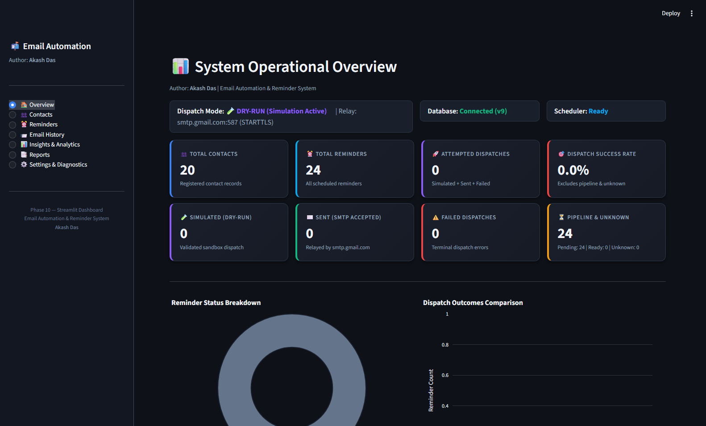
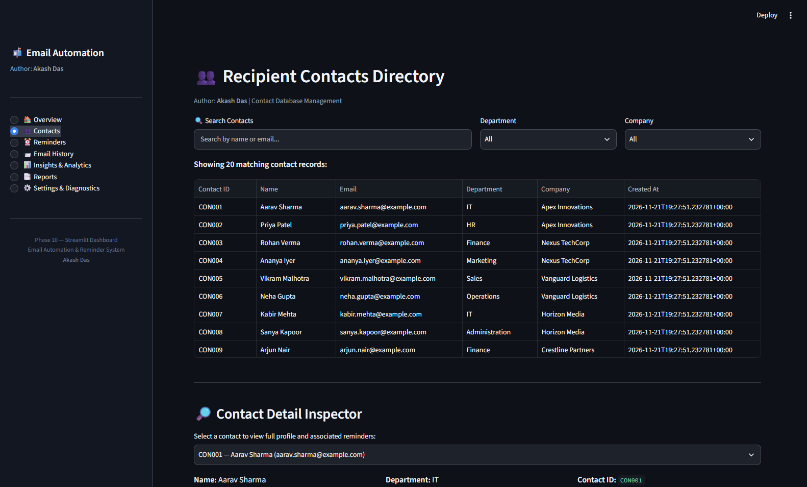

# Email Automation & Reminder System

Author: Akash Das  
Role: System Architect and Developer  
Project Repository: email-automation-reminder-system  
Development Environment: Antigravity IDE (VS Code-based)  
Project Lead and Reviewer: ChatGPT  

[](https://www.python.org/)
[](https://streamlit.io/)
[](https://pandas.pydata.org/)
[](https://plotly.com/)
[](https://www.sqlite.org/wal.html)
[](tests/)
[](LICENSE)
[](https://www.microsoft.com/windows)
[](#24-privacy-security-and-ethical-safeguards)

---

## Table of Contents

1. [Project Overview](#1-project-overview)
2. [Project Objectives](#2-project-objectives)
3. [Key Features](#3-key-features)
4. [Technology Stack](#4-technology-stack)
5. [System Architecture](#5-system-architecture)
6. [Data Workflow and Processing Pipeline](#6-data-workflow-and-processing-pipeline)
7. [Email Template Architecture and Personalization Engine](#7-email-template-architecture-and-personalization-engine)
8. [Temporal Scheduling and Due-Date Evaluation](#8-temporal-scheduling-and-due-date-evaluation)
9. [Two-Phase Gated Dispatch and Transport Protocol](#9-two-phase-gated-dispatch-and-transport-protocol)
10. [Dual-Destination Logging and Audit Trail](#10-dual-destination-logging-and-audit-trail)
11. [Insights and Analytical Interpretation Engine](#11-insights-and-analytical-interpretation-engine)
12. [Synthetic and Benchmark Dataset Description](#12-synthetic-and-benchmark-dataset-description)
13. [Streamlit Operations Dashboard](#13-streamlit-operations-dashboard)
14. [Dashboard Screenshot Gallery](#14-dashboard-screenshot-gallery)
15. [Operational CSV and Tabular Report Generation](#15-operational-csv-and-tabular-report-generation)
16. [Project Directory Structure](#16-project-directory-structure)
17. [Virtual Environment Setup and Installation](#17-virtual-environment-setup-and-installation)
18. [Dependency Installation](#18-dependency-installation)
19. [Environment Configuration](#19-environment-configuration)
20. [Database Initialization and CLI Execution](#20-database-initialization-and-cli-execution)
21. [Launching the Streamlit Dashboard](#21-launching-the-streamlit-dashboard)
22. [Running Automated Tests and Quality Assurance](#22-running-automated-tests-and-quality-assurance)
23. [Example Operational Workflow](#23-example-operational-workflow)
24. [Privacy, Security, and Ethical Safeguards](#24-privacy-security-and-ethical-safeguards)
25. [Limitations](#25-limitations)
26. [Future Improvements](#26-future-improvements)
27. [Contribution Guidelines](#27-contribution-guidelines)
28. [License and Author Information](#28-license-and-author-information)
29. [Technical Documentation Index](#29-technical-documentation-index)

---

## 1. Project Overview

The Email Automation & Reminder System is an enterprise-grade, modular Python application engineered to solve critical operational challenges in scheduled business communications, client follow-ups, deadline tracking, and compliance auditing.

In many operational environments, task reminders and follow-up notices are dispatched manually or through fragmented scripts. This leads to missed deadlines, unrecorded dispatches, duplicate notifications, and severe security risks such as accidental live transmissions during system testing. 

This project delivers a robust, reliable, and decoupled software system that automates the entire lifecycle of scheduled communications:
- Centralizes contact directories and reminder schedules in an ACID-compliant SQLite datastore.
- Evaluates temporal deadlines automatically using independent scheduler loops.
- Injects validated contact attributes into reusable text and HTML email templates.
- Enforces strict two-phase gated dispatches with simulated dry-run safety by default.
- Provides a high-contrast, permanent Dark Mode Streamlit operations dashboard for monitoring, queue management, and analytical diagnosis.

Intended users include operations managers, department administrators, customer success teams, and technical auditors who require transparent, dependable, and auditable communication workflows.

---

## 2. Project Objectives

- Architectural Separation of Concerns: Decouple the user interface, scheduling engine, templating services, database persistence, and email transport layers into maintainable modules.
- Absolute Transport Safety: Guarantee that no live email transmission occurs during testing or development unless explicitly authorized via environment variables and recipient allowlisting.
- Deterministic Template Rendering: Eliminate template hallucination and incomplete messages through strict placeholder validation and HTML escaping.
- Resilient Concurrency: Implement SQLite Write-Ahead Logging (WAL) mode to support concurrent multi-reader operations from the Streamlit UI alongside atomic single-writer background updates.
- Operational Transparency: Maintain an exhaustive dual-destination audit trail across disk log files and relational database activity tables.
- Comprehensive Verification: Validate every module, state machine transition, and edge case with extensive automated unit and integration tests.

---

## 3. Key Features

- Contact Directory Management: Ingests, validates, and stores corporate contact records with full department, company, and email format validation (RFC 5322 regex).
- Structured Reminder Queuing: Manages tasks across four priority tiers (Low, Medium, High, Urgent) and five operational categories (Meeting, Payment, Deadline, Follow-Up, General Notice).
- Contextual Personalization Engine: Merges contact attributes dynamically into email subject lines and message bodies with strict placeholder contracts.
- Gmail SMTP Integration: Standardized STARTTLS email transport over port 587 supporting secure 16-character Google App Passwords.
- Dry-Run Simulation Mode: Default execution mode that builds full MIME messages, validates recipient parameters, and logs audit events without making external network calls.
- Protected Two-Phase Dispatch: Atomic claim mechanism locks reminders in a processing state before transport invocation, preventing duplicate transmission across parallel threads.
- Autonomous Scheduling Engine: Temporal evaluation loop queries due records where scheduled time has arrived and transitions statuses safely.
- SQLite Datastore in WAL Mode: Multi-reader, single-writer relational persistence with 5000ms busy timeout protection and foreign key constraint enforcement.
- Dual-Destination Activity Logging: Real-time logging writing concurrently to rotating filesystem logs and the SQLite activity_logs table.
- Certified Operational Reports: One-click generation of formatted CSV files for contacts, reminders, dispatch histories, and system health summaries.
- Streamlit Operations Dashboard: Complete web-based operational control center featuring seven dedicated pages rendered permanently in Dark Mode.
- Phase 11 Analytical Interpretation Engine: Real-time calculation of dispatch success ratios, workload lead-time distributions, department rankings, and automated narrative findings.
- 129 Automated Tests: Exhaustive test suite providing 100 percent pass rate across personalization, scheduling, transport, logging, dashboard, and analytical components.

---

## 4. Technology Stack

| Architectural Layer | Technology | Version | Operational Role |
| :--- | :--- | :--- | :--- |
| Core Language | Python | 3.11.0 | Primary application runtime, standard library, and typing |
| Web Dashboard | Streamlit | 1.67.0 | Reactive operations interface and session state management |
| Data Manipulation | Pandas | 3.1.1 | Dataframe transformations, aggregations, and CSV generation |
| Data Visualization | Plotly | 7.1.0 | Dark-themed interactive charts (donuts, histograms, bars) |
| Relational Storage | SQLite | 3 (WAL Mode) | Persistent datastore with Write-Ahead Logging concurrency |
| Email Transport | smtplib / email | Standard Library | RFC 5322 MIME message construction and SMTP transport |
| Task Scheduling | schedule | 1.2.2 | Background temporal polling and job orchestration |
| Environment Config | python-dotenv | 1.2.1 | Secure environment variable parsing from local .env files |
| Test Framework | pytest | 9.2.0 | Automated unit, regression, and migration testing |
| Source Control | Git / GitHub | Latest | Version control, release tagging, and project documentation |

---

## 5. System Architecture

The Email Automation & Reminder System is architected as a multi-tier decoupled system. The presentation layer (Streamlit) interacts exclusively with domain services and the SQLite datastore, while the transport layer is isolated behind a strict safety gate.

```
+-------------------------------------------------------------------------+
|                  Presentation Tier (Streamlit Dark Mode)                |
|  dashboard/app.py | 7 Pages | metrics.py | charts.py | tables.py        |
+-------------------------------------------------------------------------+
                                    |
                                    v
+-------------------------------------------------------------------------+
|                       Application & Service Tier                        |
|  ReminderService    | EmailService (Mailer)   | PersonalizationEngine   |
|  ReportGenerator    | InterpretationEngine    | AppConfig               |
+-------------------------------------------------------------------------+
                    |                               |
                    v                               v
+-------------------------------------+   +-------------------------------+
|      Persistence & Audit Tier       |   |       Transport Tier          |
|  SQLite (WAL Mode): reminders.db    |   |  Gating: DRY_RUN Check        |
|  Tables: contacts, reminders, logs  |   |  True: Simulation Sink        |
|  File: logs/email_automation.log    |   |  False: Gmail SMTP (TLS 587)  |
+-------------------------------------+   +-------------------------------+
```

### Module Responsibilities

- src/email_automation/config.py: Manages AppConfig and SmtpConfig, parses environment variables, enforces dry-run defaults, and masks credentials.
- src/email_automation/database.py: Implements DatabaseManager, handles linear schema migrations (v1 to v9), configures WAL mode, executes CRUD queries, and runs integrity checks.
- src/email_automation/personalization.py: PersonalizationEngine loads templates, validates placeholder presence, sanitizes inputs, and escapes HTML characters.
- src/email_automation/reminder_service.py: ReminderService evaluates temporal due dates, transitions reminder states, and orchestrates batch execution.
- src/email_automation/mailer.py: EmailService executes two-phase gated dispatches, manages SMTP TLS handshakes, handles retries, and records delivery outcomes.
- src/email_automation/insights.py: Analytical interpretation engine computing operational KPIs, time-horizon distributions, department rankings, and narrative diagnostics.
- src/email_automation/logger.py: Multi-destination logging utility that directs structured events to rotating files and SQLite activity tables.
- src/email_automation/report_generator.py: Compiles operational summaries, exports datasets to CSV, and generates system health diagnostics.

### Reminder Lifecycle State Machine

A reminder progresses through a finite, deterministic set of operational states:

```
[Imported/Created]
        |
        v
    (pending) --------[Due Date Reached & Rendered]--------> (ready)
        |                                                       |
        |                                                       v
        |                                                 (processing) [Atomic Claim]
        |                                                       |
        +-----------------------------------+-------------------+
                                            |
                         +------------------+------------------+
                         |                                     |
                  [DRY_RUN = True]                      [DRY_RUN = False]
                         |                                     |
                         v                                     v
                    (simulated)                              (sent) [SMTP 250 OK]
                         |                                     |
                         v                                     v
                    [Terminated]                          [Terminated]
                                                               |
                                            +------------------+------------------+
                                            |                                     |
                                    [SMTP/Network Error]                   [Connection Drop]
                                            |                                     |
                                            v                                     v
                                         (failed)                        (delivery_unknown)
                                            |                                     |
                                    [Retry / Review]                       [Manual Audit]
```

---

## 6. Data Workflow and Processing Pipeline

The system processes data across five distinct, sequential lifecycle stages:

```
+------------------+     +------------------+     +------------------+
|     Stage 1      |     |     Stage 2      |     |     Stage 3      |
|   Ingestion &    | --> |   Temporal Due   | --> |  Personalization |
|    Validation    |     |    Evaluation    |     |   & Rendering    |
+------------------+     +------------------+     +------------------+
                                                           |
                                                           v
+------------------+                              +------------------+
|     Stage 5      |                              |     Stage 4      |
|  Dual Auditing & | <--------------------------- |    Two-Phase     |
|  Interpretation  |                              |  Gated Dispatch  |
+------------------+                              +------------------+
```

### Stage 1: Ingestion and Validation
Contact records and reminder schedules are imported from CSV files or entered manually through the dashboard. The system validates email syntax against RFC 5322 regex rules, parses due dates into ISO 8601 timestamps, and enforces foreign key references between reminders and contacts.

### Stage 2: Temporal Due-Date Evaluation
The scheduler periodically queries the SQLite database for records matching:
```sql
SELECT * FROM reminders WHERE status = 'pending' AND datetime(due_date) <= datetime('now');
```
Records whose scheduled deadline is in the future remain safely in the pending state.

### Stage 3: Template Personalization and Rendering
The PersonalizationEngine retrieves the designated text and HTML templates from `templates/email_templates/`. It maps contact attributes (name, company, department) and reminder metadata (task name, due date, priority) to template placeholders. If any required placeholder is missing, a MissingPlaceholderError is raised, preventing malformed email generation. Successfully rendered reminders advance to the ready state.

### Stage 4: Two-Phase Gated Dispatch
To ensure idempotency in concurrent environments:
1. Claim Phase: The mailer atomically updates the status from `ready` to `processing`.
2. Gated Transport:
   - If `DRY_RUN=True`: The MIME message is verified and routed to an internal simulation sink, transitioning the status to `simulated`.
   - If `DRY_RUN=False`: The mailer verifies the recipient against `ALLOWED_RECIPIENTS`, establishes a STARTTLS connection with `smtp.gmail.com:587`, authenticates with the Google App Password, and sends the message. Upon receiving a `250 OK` server acknowledgment, the status transitions to `sent`.
   - In case of network errors or authentication failures, the reminder increments its retry counter and transitions to `failed`.
   - If a connection drops after the `DATA` phase, the reminder transitions to `delivery_unknown` to prevent double-sending.

### Stage 5: Dual Auditing and Analytical Interpretation
Every dispatch event triggers dual audit records: a human-readable entry in `logs/email_automation.log` and a structured row in the SQLite `activity_logs` table. The InterpretationEngine reads these logs to evaluate delivery success ratios, department workloads, and generate dynamic findings.

---

## 7. Email Template Architecture and Personalization Engine

The templating subsystem (`src/email_automation/personalization.py`) provides deterministic, type-safe, and personalizable message construction:

### Dual Format Storage
Templates are stored as paired plain-text (`.txt`) and rich hypertext (`.html`) files in `templates/email_templates/`:
- `meeting_reminder`: Operational synchronization meetings, agenda reviews, and scheduled calls.
- `payment_reminder`: Pending corporate invoices, billing notices, and accounts receivable alerts.
- `deadline_reminder`: Action-required project milestones, audit submissions, and compliance deadlines.
- `follow_up_reminder`: Status inquiries, pending deliverables, and unacknowledged threads.
- `general_reminder`: Organizational announcements and administrative notices.

### Placeholder Contracts and Input Sanitization
The PersonalizationEngine enforces a strict context contract. Each template declares its required variables:
- Supported Placeholders: `{name}`, `{task_name}`, `{due_date}`, `{priority}`, `{company}`, `{department}`, `{reference_id}`.
- Deterministic Substitution: In-memory string replacement maps contact metadata directly into message bodies and dynamic subject lines.
- HTML Escaping: Values merged into HTML templates pass through `html.escape()` to neutralize special characters (`<`, `>`, `&`, `"`, `'`), preventing cross-site scripting (XSS) and MIME boundary distortion.
- Contract Integrity: If any mandatory placeholder cannot be resolved from the contact or reminder record, the engine raises a `MissingPlaceholderError`. The reminder remains unrendered rather than emitting an incomplete message with bare `{placeholder}` tokens.

---

## 8. Temporal Scheduling and Due-Date Evaluation

The scheduling engine (`src/email_automation/scheduler.py` and `src/email_automation/reminder_service.py`) coordinates autonomous timeline execution:

### Polling Loop and Timezone Awareness
- Independent Polling: The background scheduler evaluates the database at regular configurable intervals (e.g., 60 seconds) independently of the dashboard session.
- ISO 8601 Parsing: Scheduled timestamps are normalized into standard ISO 8601 format with timezone offsets. The SQL engine compares deadlines using UTC normalized timestamps:
  ```sql
  SELECT reminder_id FROM reminders 
  WHERE status = 'pending' AND datetime(due_date) <= datetime('now');
  ```
- State Transition Boundary: When a pending task matures, the service loads contact data, triggers the PersonalizationEngine, renders the message, and updates the status to `ready` within an atomic database transaction.

### Concurrency and Deduplication Safeguards
- Duplicate Suppression: The engine checks existing active records before registering reminders, preventing duplicate tasks for the same contact, category, and scheduled timestamp.
- Atomic Rollback: If an error occurs during template rendering or database commit, the transaction rolls back cleanly, leaving the reminder in `pending` status without corrupting adjacent queue entries.

---

## 9. Two-Phase Gated Dispatch and Transport Protocol

The transport subsystem (`src/email_automation/mailer.py`) implements a secure two-phase dispatch protocol designed for high-concurrency environments:

### The Two-Phase Gated Claim Architecture
1. Phase 1 (Atomic Claim):
   ```sql
   UPDATE reminders 
   SET status = 'processing', updated_at = CURRENT_TIMESTAMP 
   WHERE reminder_id = :id AND status = 'ready';
   ```
   By locking the record into `processing` before opening transport connections, parallel worker threads or simultaneous UI clicks cannot double-dispatch the same message.
2. Phase 2 (Gated Transport):
   - Simulation Gate (`DRY_RUN=True`): Constructs a complete `MIMEMultipart` email with alternative text and HTML parts. Instead of opening sockets, the payload is directed to an internal simulation sink, verified, and committed as `simulated`.
   - Production Gate (`DRY_RUN=False`): Verifies that recipient addresses exist on `ALLOWED_RECIPIENTS`. Connects to `smtp.gmail.com:587`, initiates STARTTLS encryption, authenticates with `SMTP_APP_PASSWORD`, and transmits the message. Upon receiving server response code `250 OK`, the status transitions to `sent`.

### Exception Classification and Ambiguous Handling
- Transient Network Failures: Connection timeouts (`socket.timeout`) or server busy codes (`421`) increment `retry_count`. If below `MAX_RETRIES` (default 3), the status resets to `ready` for the next cycle. If exceeded, it transitions to `failed`.
- Authentication Failures: Immediate rejection (`535 Authentication credentials invalid`) halts the batch run and records an alert to prevent account lockouts.
- Conservative Ambiguity Isolation (`delivery_unknown`): If a socket connection drops after the `DATA` command is sent but before the server response code is acknowledged, the transaction is marked as `delivery_unknown`. Crucially, automated retries are permanently forbidden for `delivery_unknown` records to prevent duplicate recipient deliveries. These cases are flagged for manual operator review.

---

## 10. Dual-Destination Logging and Audit Trail

The auditing architecture (`src/email_automation/logger.py`) maintains parallel audit records across two distinct destinations:

### 1. Rotating Filesystem Logger
- Log Destination: `logs/email_automation.log`.
- Log Rotation: Uses a standard rotating file handler configured with a 5 MB file size threshold and a backup count of 5 archive files, preventing disk saturation.
- Formatting: Standardized format containing timestamp, severity level, module name, and event message:
  ```text
  2026-11-23 20:30:15 [INFO] mailer: SIMULATED dispatch for REM001 to aarav.sharma@example.com (Subject: Meeting Reminder: Sync session)
  ```

### 2. Relational SQLite Activity Table
- Table: `activity_logs` (`log_id`, `timestamp`, `event_type`, `severity`, `reminder_id`, `contact_id`, `status`, `message`, `details`).
- Schema Migrations: A linear migration engine supports automatic schema upgrades (Version 1 through Version 9), ensuring legacy schemas upgrade safely without data loss.
- Fail-Soft Design: If database logging fails due to a transient file lock, filesystem logging continues unimpeded.
- Credential Redaction: All authentication tokens, passwords, and sensitive keys are stripped and masked prior to emission.

---

## 11. Insights and Analytical Interpretation Engine

The Phase 11 analytical interpretation engine (`src/email_automation/insights.py`) evaluates operational metrics and produces dynamic diagnostic observations:

### Standardized Delivery Success Metric
To prevent ambiguous calculations, operational success is evaluated strictly against attempted dispatches:
$$\text{Delivery Success Rate} = \frac{\text{Simulated} + \text{Sent}}{\text{Total Attempted}} \times 100\%$$
- Total Attempted: Calculated as $\text{Simulated} + \text{Sent} + \text{Failed}$.
- Excluded States: Reminders in `pending`, `ready`, and `processing` states are excluded from the denominator.
- Ambiguous Handling: Records in `delivery_unknown` are tracked in a dedicated audit counter and excluded from the success denominator.
- Zero-Division Protection: If zero dispatches have been attempted, the engine safely returns `"N/A"` rather than raising an arithmetic error.

### Strict Actionable Upcoming Workload Filtering
Upcoming workload calculation separates active future requirements from historical past-due records:
- Actionable Upcoming Criteria: Reminders where scheduled deadline is in the future ($T_{\text{due}} > \text{now}$) AND status is strictly in `('pending', 'ready')`.
- Excluded Completed Records: Finished terminal records (`simulated`, `sent`, `failed`, `delivery_unknown`) with future timestamps are excluded, preventing completed tasks from inflating upcoming operational demands.

### Dynamic Workload and Department Rankings
The engine dynamically computes workload density across corporate departments and functional categories:
- Lead-Time Horizons: Reminders are bucketed into Past-Due, Due Today, Due Tomorrow, Next 7 Days, and Future (>7 Days).
- Department Concentration: Identifies which departments (e.g., Engineering vs Marketing) hold the largest share of active reminders.
- Automated Narrative Findings: Generates structured findings cards (Normal, Info, Alert) summarizing delivery reliability, workload peaks, and actionable workload balancing recommendations.

---

## 12. Synthetic and Benchmark Dataset Description

The project is supplied with a comprehensive synthetic benchmark dataset located in `data/sample/`:

### Contacts Dataset (`data/sample/contacts.csv`)
Contains 20 verified corporate contact profiles distributed across seven functional departments:
- Departments: Engineering (4), Marketing (3), Sales (3), Operations (3), IT (3), Finance (2), Administration (2).
- Companies: Apex Innovations, Nexus TechCorp, Vanguard Logistics, Horizon Media, Crestline Partners.
- Data Invariants: All email addresses utilize the standard reserved RFC 2606 domain (`@example.com`) to prevent accidental external deliveries during development.

### Reminders Dataset (`data/sample/reminders.csv`)
Contains 24 structured operational tasks linked via foreign keys to the contact directory:
- Priority Distribution: Low (4), Medium (8), High (8), Urgent (4).
- Category Distribution: Meeting (5), Payment (5), Deadline (5), Follow-Up (5), General Notice (4).
- Temporal Baseline: All sample reminders are baseline-scheduled for January 2027. This deliberate temporal offset guarantees that when a developer initializes the database, the sample tasks remain in a clean future `pending` state, allowing deterministic testing of due-date triggers without unmanaged past-due collisions.

---

## 13. Streamlit Operations Dashboard

The dashboard provides an intuitive, high-contrast operational graphical interface built on Streamlit:

### Architecture and Design System
- Permanent Dark Mode: Built with an ergonomic slate palette (`#0F172A` deep navy background, `#1E293B` container surfaces, `#38BDF8` celestial cyan accents, `#10B981` emerald success, `#F59E0B` amber warnings, `#EF4444` coral errors). There are zero user-facing theme switches, ensuring visual consistency.
- Session State Persistence: Filter selections, active drill-downs, and pagination states persist cleanly across component re-renders.
- Sanitized Table Rendering: All tabular data is routed through a centralized helper (`dashboard/components/tables.py`) that enforces valid content-based auto-heights, permanently eliminating `StreamlitInvalidHeightError` exceptions.

### Seven Dedicated Dashboard Pages
1. Overview: Executive KPI ribbon, status distribution donut chart, dispatch outcome comparison bar chart, manual dispatch trigger, and real-time activity stream.
2. Contacts: Filterable contact directory, department filters, and individual contact inspector displaying linked reminder tasks.
3. Reminders: Multi-criterion filtering by status, priority, and category, operational table, interactive live template preview modal, and manual reminder creation form.
4. Email History: Full audit log of all dispatch attempts, filterable by outcome (simulated, sent, failed, delivery_unknown), with expandable raw payload inspectors.
5. Insights & Analytics: Phase 11 analytical engine displaying delivery success metrics, upcoming actionable workload, time-horizon distribution charts, department workload bars, and automated narrative findings.
6. Reports: Certified one-click CSV report generators for reminders, contacts, and activity logs, alongside system health summaries.
7. Settings & Diagnostics: Environment configuration inspection, safe masked credential verification, SQLite WAL schema diagnostics, table record counters, and sample data synchronization.

---

## 14. Dashboard Screenshot Gallery

All high-resolution reference screenshots are located in `images/dashboard/`:

### Overview Dashboard


The Overview page serves as the primary executive monitoring cockpit. It displays four top-level KPI metric cards showing Total Reminders (24), Pending Workload (24), Ready for Dispatch (0), and Processed Dispatches (0). In the center, an interactive Plotly donut chart visualizes the reminder status breakdown (100 percent pending in the initial baseline), adjacent to a dispatch outcome comparison bar chart. Below the charts, the operator has access to an interactive "Process Due Reminders Now" trigger button for manual batch runs, followed by a live activity table streaming the latest system logs with severity badges.

---

### Contacts Directory


The Contacts page provides a centralized directory for managing recipient profiles. An interactive search bar at the top enables instant real-time filtering by contact name, email address, department, or company affiliation. The main responsive table displays contact records from CON001 through CON020. Below the table, the Contact Detail Inspector dropdown allows the operator to isolate an individual profile (such as Aarav Sharma, IT Department at Apex Innovations) and view all associated reminder tasks linked to that individual.

---

### Reminders Management


The Reminders page is the operational center for task scheduling. A multi-criterion filter toolbar allows operators to filter records by status (pending, ready, simulated, sent, failed), priority tier (low, medium, high, urgent), and category. The main operational table displays reminder IDs, recipient contacts, task titles, scheduled due dates, and priority badges. Operators can expand any individual reminder to access the live template preview modal, which renders both plain-text and HTML email previews with all placeholder variables dynamically populated. The page also includes a form for registering new reminder tasks.

---

### Email History and Audit Trail


The Email History page delivers a complete historical ledger of all email dispatch events. Operators can filter transactions by execution outcome: All, Simulated, Sent (SMTP Accepted), Failed, or Delivery Unknown. The audit table records the exact timestamp, recipient address, email subject line, transport channel utilized, and final delivery status. Each row includes an expandable inspector that reveals the complete MIME headers, rendered body content, and remote SMTP server acknowledgment codes.

---

### Insights & Analytics


The Insights & Analytics page houses the Phase 11 analytical interpretation engine. At the top, operational metric cards report total dispatch attempts, realized delivery success rates, failure ratios, and actionable upcoming workload. The workload distribution chart groups reminders across chronological lead-time horizons (Past-Due, Due Today, Due Tomorrow, Next 7 Days, Beyond 7 Days). A horizontal bar chart breaks down workload density by corporate department. Below the charts, automated narrative findings cards translate quantitative database metrics into plain-language diagnostic observations and actionable workload balancing recommendations.

---

### Reports and Data Exports


The Reports page enables operators to export certified operational datasets for offline compliance, business review, and spreadsheet analysis. Three dedicated export cards feature one-click download buttons for `reminders_export.csv`, `contacts_export.csv`, and `activity_logs_export.csv`. The page also generates an on-demand consolidated System Health and Operational Summary report detailing database schema integrity, table record totals, and delivery reliability metrics.

---

### Settings & System Diagnostics


The Settings & Diagnostics page provides deep visibility into application configuration and database health. The Configuration Overview panel displays active execution mode (Dry-Run indicator), database file path, template directory, and SMTP connection parameters with sensitive passwords securely masked. Below, the Database Diagnostics panel runs live SQLite integrity checks (`PRAGMA integrity_check`), displaying active schema version (Version 9 in SQLite WAL mode) and real-time record counts across contacts, reminders, and activity log tables.

---

## 15. Operational CSV and Tabular Report Generation

The reporting subsystem (`src/email_automation/report_generator.py`) generates certified, audit-ready data exports in tabular CSV format compatible with Microsoft Excel, Google Sheets, and automated analytical pipelines:

- Reminders Operational Export (`outputs/reports/reminders_report.csv`): Exports all task records with contact names, email addresses, priority levels, categories, scheduled due dates, and current lifecycle statuses.
- Contact Directory Export (`outputs/reports/contacts_report.csv`): Exports the complete organizational contact directory with department and company affiliations.
- System Activity History Export (`outputs/reports/activity_logs_report.csv`): Exports the complete timestamped audit trail of all application events, error stack traces, and email dispatches.
- System Health Summary: A consolidated text and markdown diagnostic report compiling database integrity results, foreign key validations, and delivery performance metrics.

---

## 16. Project Directory Structure

```
email-automation-reminder-system/
|-- .env.example
|-- .gitignore
|-- CONTRIBUTING.md
|-- LICENSE
|-- README.md
|-- pytest.ini
|-- requirements.txt
|-- main.py
|-- run_dashboard.py
|-- .streamlit/
|   `-- config.toml
|-- .vscode/
|   `-- settings.json
|-- dashboard/
|   |-- __init__.py
|   |-- app.py
|   |-- components/
|   |   |-- __init__.py
|   |   |-- charts.py
|   |   |-- metrics.py
|   |   |-- tables.py
|   |   `-- theme.py
|   `-- pages/
|       |-- __init__.py
|       |-- contacts.py
|       |-- email_history.py
|       |-- insights.py
|       |-- overview.py
|       |-- reminders.py
|       |-- reports.py
|       `-- settings.py
|-- data/
|   |-- database/
|   |   `-- .gitkeep
|   `-- sample/
|       |-- .gitkeep
|       |-- contacts.csv
|       `-- reminders.csv
|-- docs/
|   |-- ARCHITECTURE.md
|   |-- DATASET_DICTIONARY.md
|   |-- DATA_FLOW.md
|   |-- EMAIL_PERSONALIZATION_GUIDE.md
|   |-- EMAIL_SENDING_GUIDE.md
|   |-- EMAIL_TEMPLATE_GUIDE.md
|   |-- EXECUTION_LOG.md
|   |-- INSIGHTS_AND_INTERPRETATION_GUIDE.md
|   |-- LOGGING_AND_REPORTING_GUIDE.md
|   |-- MODULE_SPECIFICATIONS.md
|   |-- PROJECT_OVERVIEW.md
|   |-- README.md
|   |-- REMINDER_SCHEDULING_GUIDE.md
|   |-- SCREENSHOT_GUIDE.md
|   |-- SMTP_CONFIGURATION_GUIDE.md
|   |-- STREAMLIT_DASHBOARD_GUIDE.md
|   |-- TESTING_GUIDE.md
|   `-- USER_GUIDE.md
|-- images/
|   |-- architecture/
|   |   `-- .gitkeep
|   `-- dashboard/
|       |-- .gitkeep
|       |-- contacts_dark.png
|       |-- email_history_dark.png
|       |-- insights_dark.png
|       |-- overview_dark.png
|       |-- reminders_dark.png
|       |-- reports_dark.png
|       `-- settings_dark.png
|-- logs/
|   `-- .gitkeep
|-- outputs/
|   |-- exports/
|   |   `-- .gitkeep
|   `-- reports/
|       `-- .gitkeep
|-- src/
|   `-- email_automation/
|       |-- __init__.py
|       |-- config.py
|       |-- database.py
|       |-- importer.py
|       |-- insights.py
|       |-- logger.py
|       |-- mailer.py
|       |-- models.py
|       |-- personalization.py
|       |-- reminder_service.py
|       |-- report_generator.py
|       |-- scheduler.py
|       |-- smtp_config.py
|       `-- validator.py
|-- templates/
|   `-- email_templates/
|       |-- .gitkeep
|       |-- deadline_reminder.html
|       |-- deadline_reminder.txt
|       |-- follow_up_reminder.html
|       |-- follow_up_reminder.txt
|       |-- general_reminder.html
|       |-- general_reminder.txt
|       |-- meeting_reminder.html
|       |-- meeting_reminder.txt
|       |-- payment_reminder.html
|       `-- payment_reminder.txt
`-- tests/
    |-- .gitkeep
    |-- __init__.py
    |-- test_dashboard.py
    |-- test_insights.py
    |-- test_logging_reporting.py
    |-- test_mailer.py
    |-- test_personalization.py
    `-- test_scheduling.py
```

---

## 17. Virtual Environment Setup and Installation

The application is engineered for Python 3.11 on Windows 10/11 using PowerShell:

### Step 1: Clone Repository
```powershell
git clone https://github.com/Risdane/email-automation-reminder-system.git
cd "email-automation-reminder-system"
```

### Step 2: Open in VS Code
```powershell
code .
```

### Step 3: Create Virtual Environment
```powershell
python -m venv .venv
```

### Step 4: Activate Virtual Environment
```powershell
Set-ExecutionPolicy -ExecutionPolicy RemoteSigned -Scope Process
.\.venv\Scripts\Activate.ps1
```

---

## 18. Dependency Installation

Upgrade pip and install all pinned production dependencies:

```powershell
.\.venv\Scripts\python.exe -m pip install --upgrade pip
.\.venv\Scripts\python.exe -m pip install -r requirements.txt
```

---

## 19. Environment Configuration

Copy the provided `.env.example` file to create your local `.env`:

```powershell
Copy-Item .env.example .env
```

### Environment Variables Reference

| Variable Name | Data Type | Default Value | Purpose and Description |
| :--- | :--- | :--- | :--- |
| DRY_RUN | Boolean | True | Operational safety switch. When True, all sending is simulated. |
| DATABASE_PATH | Path | data/database/reminders.db | Local filesystem path to the SQLite datastore. |
| TEMPLATES_DIR | Path | templates/email_templates | Path to directory containing text and HTML templates. |
| LOG_FILE | Path | logs/email_automation.log | Destination path for rotating system logs. |
| SMTP_HOST | String | smtp.gmail.com | Remote SMTP server host. |
| SMTP_PORT | Integer | 587 | Remote SMTP server port (587 for STARTTLS). |
| SMTP_SENDER_EMAIL | String | empty | Authorized sender Gmail address. |
| SMTP_APP_PASSWORD | String | empty | 16-character Google App Password (never personal password). |
| ALLOWED_RECIPIENTS | String | empty | Comma-separated list of authorized recipient emails in live mode. |

### Gmail SMTP Setup Instructions
1. Navigate to Google Account Security.
2. Enable 2-Step Verification if not active.
3. Search for App Passwords.
4. Create an App Password with the name `EmailAutomationSystem`.
5. Google generates a 16-character passcode (e.g., `abcd efgh ijkl mnop`).
6. Set `SMTP_APP_PASSWORD=abcdefghijklmnop` in your local `.env`.
7. Configure `SMTP_SENDER_EMAIL=your_email@gmail.com`.
8. Never commit `.env` to Git; it is strictly excluded by `.gitignore`.

---

## 20. Database Initialization and CLI Execution

Initialize the database schema and populate the benchmark dataset:

```powershell
# Create SQLite tables and apply versioned migrations
.\.venv\Scripts\python.exe main.py --init-db

# Sync sample contacts and reminders from CSV files
.\.venv\Scripts\python.exe main.py --sync-sample-data

# Execute an immediate temporal check and batch dispatch pass
.\.venv\Scripts\python.exe main.py --run-once
```

---

## 21. Launching the Streamlit Dashboard

Start the interactive permanent Dark Mode dashboard:

```powershell
.\.venv\Scripts\python.exe -m streamlit run run_dashboard.py
```

Or via direct app entrypoint:

```powershell
.\.venv\Scripts\python.exe -m streamlit run dashboard/app.py
```

Open your browser to:
`http://localhost:8501`

---

## 22. Running Automated Tests and Quality Assurance

Execute the complete automated test suite with pytest:

```powershell
.\.venv\Scripts\python.exe -m pytest tests/ -v
```

### Observed Test Verification

```
============================= test session starts =============================
platform win32 -- Python 3.11.0, pytest-9.2.0, pluggy-1.7.0
rootdir: D:\Projects\Python\Email Automation & Reminder System
configfile: pytest.ini
collected 129 items

tests/test_dashboard.py ........................                         [ 18%]
tests/test_insights.py ...............                                   [ 30%]
tests/test_logging_reporting.py .........................                [ 49%]
tests/test_mailer.py .......................                             [ 67%]
tests/test_personalization.py .....................                      [ 83%]
tests/test_scheduling.py .....................                           [100%]

============================ 129 passed in 15.05s =============================
```

- tests/test_dashboard.py (24 tests): Validates dark theme styling, session state, height sanitization preventing `StreamlitInvalidHeightError`, and manual dispatch safety controls.
- tests/test_insights.py (15 tests): Tests all 7 reminder status metrics, actionable upcoming workload filtering, performance formulas, and dynamic rankings.
- tests/test_logging_reporting.py (25 tests): Verifies dual logging, database activity schema, legacy Phase 9 schema migration, and CSV export integrity.
- tests/test_mailer.py (23 tests): Validates mock SMTP transport, dry-run safety gating, retry policies, credential masking, and concurrency claiming.
- tests/test_personalization.py (21 tests): Verifies template placeholder substitution, missing placeholder exceptions, Unicode safety, and HTML escaping.
- tests/test_scheduling.py (21 tests): Tests temporal due-date checks, state transitions (`pending` to `ready`), idempotent imports, and transaction rollback boundaries.

---

## 23. Example Operational Workflow

1. Schedule Creation: An administrator registers a task reminder for contact CON001 (Aarav Sharma) titled "Quarterly Code Audit Review", due at 10:00 AM, using the `meeting_reminder` template.
2. Background Polling: The scheduler checks SQLite every 60 seconds. When system time reaches the deadline, the reminder qualifications pass.
3. Dynamic Rendering: The PersonalizationEngine loads `meeting_reminder.txt` and `meeting_reminder.html`, merges Aarav Sharma's context, validates placeholder completeness, and marks the task as `ready`.
4. Gated Claim: The mailer claims the task, atomically transitioning it to `processing`.
5. Safe Transmission: With `DRY_RUN=True`, the mailer routes the MIME message to the simulation sink, logs the payload, and marks the status as `simulated`.
6. Audit and Insights: The transaction is logged in `logs/email_automation.log` and the `activity_logs` table. The operator visits the Insights page to view the updated delivery metrics.

---

## 24. Privacy, Security, and Ethical Safeguards

- Default Simulation Enforcement: `DRY_RUN` defaults to `True` in `src/email_automation/config.py`. Even if credentials are configured, no live email can be dispatched unless `DRY_RUN=False` is explicitly set in `.env`.
- Recipient Allowlisting: When running in live mode, outgoing emails are strictly matched against `ALLOWED_RECIPIENTS`. Addresses not on the list are blocked from dispatch.
- Credential Isolation: Sensitive files (`.env`, `.streamlit/secrets.toml`) and database files are strictly excluded from version control via `.gitignore`.
- Password Masking: `AppConfig` masks passwords in string representations and logs, preventing credential leakage in tracebacks.
- Conservative Failure Handling: If a connection drops after the `DATA` phase, the record transitions to `delivery_unknown` and is never automatically retried, avoiding duplicate email reception by recipients.
- Zero Automatic Dashboard Sends: Simply opening or browsing the dashboard never sends real emails.

---

## 25. Limitations

- Single-Node Persistence: SQLite WAL mode provides high performance for local single-node deployments, but distributed multi-instance clusters would require PostgreSQL.
- Fictional Benchmark Data: The seeded 20 contacts and 24 reminders are designed for reproducible demonstration rather than stress testing at million-record scales.
- Manual Allowlist Configuration: In live mode, recipients must be manually declared in `.env` to prevent external leaks.

---

## 26. Future Improvements

- OAuth2 Gmail API Transport: Integrate Google Workspace OAuth2 token refresh as an alternative to SMTP App Passwords.
- Distributed Celery Task Queue: Enable Redis-backed task distribution for high-throughput enterprise dispatch pipelines.
- Inbound IMAP Webhook Listener: Add automatic inbound parsing to track replies and update reminder completion status automatically.

---

## 27. Contribution Guidelines

Contributions are welcome. Please review [CONTRIBUTING.md](CONTRIBUTING.md) for details on our coding standards, branch conventions, and testing protocols. All pull requests must pass the complete 129-test suite (`pytest tests/ -v`) before review.

---

## 28. License and Author Information

Author: Akash Das  
Role: System Architect and Developer  
License: MIT License. See [LICENSE](LICENSE) for full legal text.

---

## 29. Technical Documentation Index

For in-depth architectural and module specifications, consult the dedicated guides in `docs/`:

- [ARCHITECTURE.md](docs/ARCHITECTURE.md): Multi-tier decoupled architecture, SQLite WAL persistence, state machines, and concurrency design.
- [DATA_FLOW.md](docs/DATA_FLOW.md): Comprehensive 5-stage data processing pipeline and sequence diagrams.
- [USER_GUIDE.md](docs/USER_GUIDE.md): End-user operations handbook for CLI commands and 7 dashboard pages.
- [TESTING_GUIDE.md](docs/TESTING_GUIDE.md): Quality assurance protocols, mock fixtures, and test suite execution.
- [SCREENSHOT_GUIDE.md](docs/SCREENSHOT_GUIDE.md): Detailed visual walkthrough and design token specifications.
- [MODULE_SPECIFICATIONS.md](docs/MODULE_SPECIFICATIONS.md): Class interfaces, method signatures, and component contracts.
- [DATASET_DICTIONARY.md](docs/DATASET_DICTIONARY.md): Schema field types, constraints, and relational dictionary.
- [EMAIL_PERSONALIZATION_GUIDE.md](docs/EMAIL_PERSONALIZATION_GUIDE.md): Templating rules, context schemas, and validation.
- [REMINDER_SCHEDULING_GUIDE.md](docs/REMINDER_SCHEDULING_GUIDE.md): Temporal due-date checks and state transitions.
- [EMAIL_SENDING_GUIDE.md](docs/EMAIL_SENDING_GUIDE.md): Two-phase gated dispatch and transport specifications.
- [LOGGING_AND_REPORTING_GUIDE.md](docs/LOGGING_AND_REPORTING_GUIDE.md): Dual-logging architecture and CSV report generation.
- [STREAMLIT_DASHBOARD_GUIDE.md](docs/STREAMLIT_DASHBOARD_GUIDE.md): Streamlit component integration and dark theme design.
- [INSIGHTS_AND_INTERPRETATION_GUIDE.md](docs/INSIGHTS_AND_INTERPRETATION_GUIDE.md): Phase 11 analytical metrics and interpretation engine.
- [EXECUTION_LOG.md](docs/EXECUTION_LOG.md): Chronological development history and milestone records.
