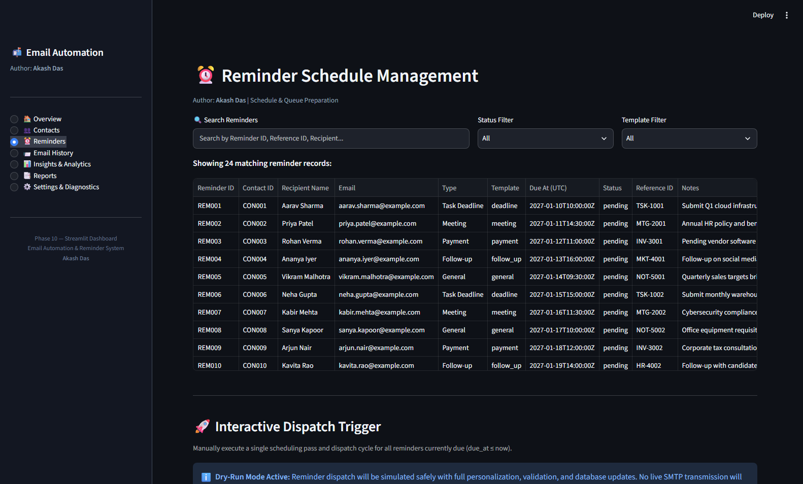
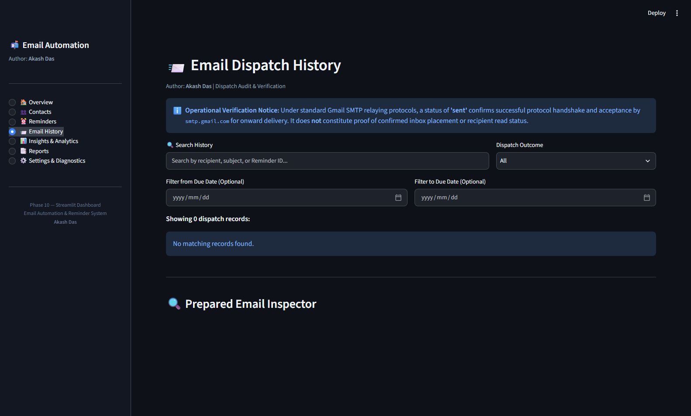
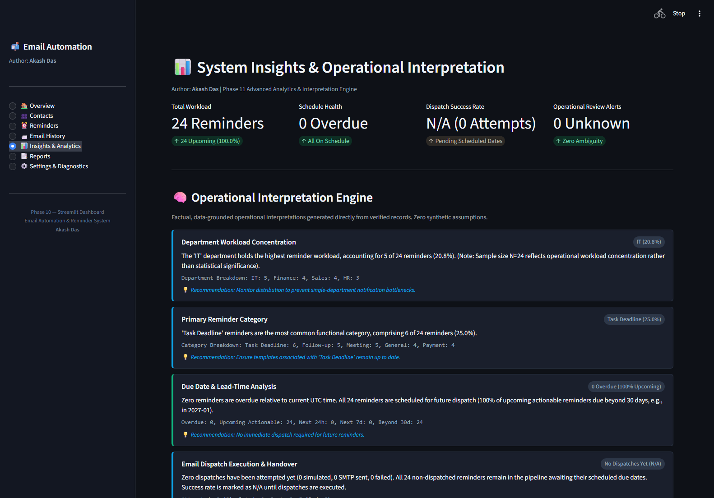
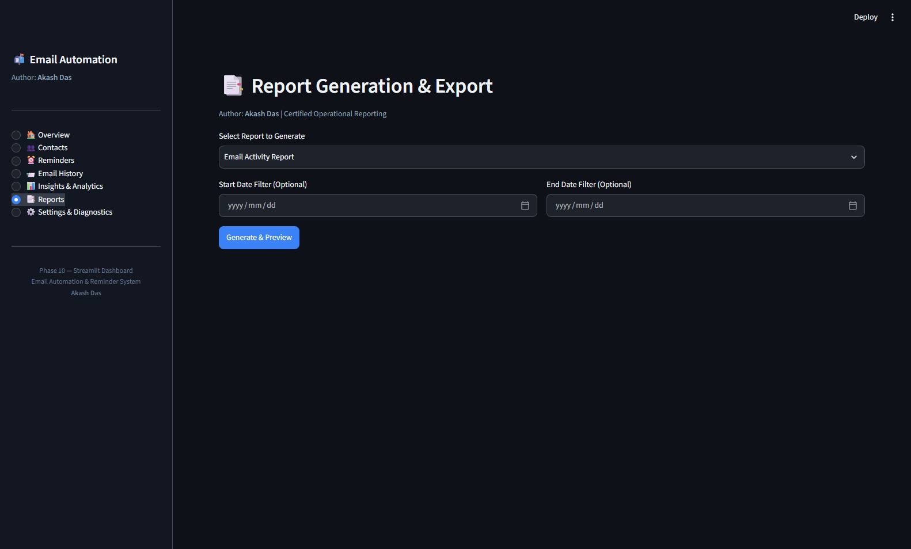
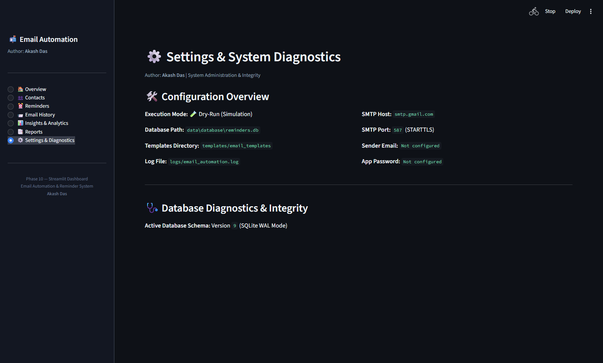

# Email Automation & Reminder System

Author: Akash Das  
Role: System Architect and Developer  
Project Repository: email-automation-reminder-system  
Development Environment: Antigravity IDE (VS Code-based)  
Project Lead and Reviewer: ChatGPT  

[](https://www.python.org/)
[](https://streamlit.io/)
[](https://pandas.pydata.org/)
[](https://plotly.com/)
[](https://www.sqlite.org/wal.html)
[](tests/)
[](LICENSE)
[](https://www.microsoft.com/windows)
[](#email-safety-and-operational-guardrails)

The Email Automation & Reminder System is a modular Python application designed to streamline business notifications, temporal task reminders, personalized email generation, and operational reporting. 

Many small to medium-sized organizations struggle with disjointed notification workflows, missed operational deadlines, and lack of auditability in ad-hoc email communications. This project addresses these challenges by combining an ACID-compliant SQLite datastore, a dynamic Jinja-style templating engine, a two-phase gated email dispatch pipeline, and an interactive Streamlit operations dashboard operating permanently in Dark Mode.

Intended users include operations teams, department leads, and system administrators who require a reliable, transparent, and auditable notification infrastructure with complete simulation protection against accidental email dispatches.

---

## Key Features

- Contact CSV Management: Ingests, normalizes, and validates contact directories with department and company associations.
- Structured Reminder Datasets: Manages task due dates, priority tiers (Low, Medium, High, Urgent), and category mappings.
- Personalized Email Templates: Reusable text and HTML email templates with dynamic placeholder substitution and strict validation.
- Gmail SMTP Configuration: Standard STARTTLS email transport on port 587 utilizing secure Google App Passwords.
- Dry-Run Email Simulation: Default simulation mode that renders, validates, and logs email payloads without opening external network connections.
- Protected Live Email Sending: Two-phase gated dispatch with recipient allowlisting, connection timeout handling, and failure classification.
- Autonomous Reminder Scheduling: Date and time evaluation identifying due tasks and advancing states independently of dashboard lifecycle.
- SQLite Datastore in WAL Mode: Multi-reader, single-writer persistence with foreign key constraints, busy timeout protection, and versioned migrations.
- Dual-Destination Activity Logging: Real-time logging to rotating files and persistent SQLite activity_logs table.
- Certified Report Generation: On-demand export of operational CSV summaries, contact rosters, and audit trails.
- Interactive Streamlit Dashboard: Multi-page web dashboard with 7 dedicated pages for operations, analytics, and diagnostics.
- Analytical Interpretation Engine: Evaluates delivery success ratios, workload concentration, and generates automated narrative findings.
- Permanent Dark Mode Interface: Ergonomic visual design using deep slate palettes with zero user-facing theme switches.
- Comprehensive Test Coverage: 129 passing automated unit and integration tests across 6 dedicated test modules.

---

## Technology Stack

| Layer | Technology | Version | Purpose |
| :--- | :--- | :--- | :--- |
| Programming Language | Python | 3.11.0 | Core application runtime and standard library |
| Web Dashboard | Streamlit | 1.67.0 | Interactive web user interface and state management |
| Data Processing | Pandas | 3.1.1 | Tabular data manipulation, aggregation, and CSV export |
| Visual Analytics | Plotly | 7.1.0 | Interactive charting (donut charts, bar charts, timelines) |
| Database Engine | SQLite | 3 (WAL Mode) | Relational datastore with Write-Ahead Logging |
| Email Transport | smtplib / email | Standard Library | RFC 5322 MIME construction and SMTP transport |
| Task Scheduling | schedule | 1.2.2 | Background task evaluation loop |
| Configuration | python-dotenv | 1.2.1 | Environment variable isolation from .env |
| Quality Assurance | pytest | 9.2.0 | Automated unit, regression, and migration testing |
| Version Control | Git / GitHub | Latest | Source control management and documentation |

---

## System Architecture

The project adheres to a multi-tier decoupled architecture where presentation, business logic, persistence, and transport concerns remain strictly separated.

```
+-------------------------------------------------------------------------+
|                  Presentation Tier (Streamlit Dark Mode)                |
|  dashboard/app.py | 7 Pages | metrics.py | charts.py | tables.py        |
+-------------------------------------------------------------------------+
                                    |
                                    v
+-------------------------------------------------------------------------+
|                       Application & Service Tier                        |
|  ReminderService    | EmailService (Mailer)   | PersonalizationEngine   |
|  ReportGenerator    | InterpretationEngine    | AppConfig               |
+-------------------------------------------------------------------------+
                    |                               |
                    v                               v
+-------------------------------------+   +-------------------------------+
|      Persistence & Audit Tier       |   |       Transport Tier          |
|  SQLite (WAL Mode): reminders.db    |   |  Gating: DRY_RUN Check        |
|  Tables: contacts, reminders, logs  |   |  True: Simulation Sink        |
|  File: logs/email_automation.log    |   |  False: Gmail SMTP (TLS 587)  |
+-------------------------------------+   +-------------------------------+
```

### Directory Structure

```
email-automation-reminder-system/
|-- .env.example
|-- .gitignore
|-- CONTRIBUTING.md
|-- LICENSE
|-- README.md
|-- pytest.ini
|-- requirements.txt
|-- main.py
|-- run_dashboard.py
|-- .streamlit/
|   `-- config.toml
|-- .vscode/
|   `-- settings.json
|-- dashboard/
|   |-- __init__.py
|   |-- app.py
|   |-- components/
|   |   |-- __init__.py
|   |   |-- charts.py
|   |   |-- metrics.py
|   |   |-- tables.py
|   |   `-- theme.py
|   `-- pages/
|       |-- __init__.py
|       |-- contacts.py
|       |-- email_history.py
|       |-- insights.py
|       |-- overview.py
|       |-- reminders.py
|       |-- reports.py
|       `-- settings.py
|-- data/
|   |-- database/
|   |   `-- .gitkeep
|   `-- sample/
|       |-- .gitkeep
|       |-- contacts.csv
|       `-- reminders.csv
|-- docs/
|   |-- ARCHITECTURE.md
|   |-- DATASET_DICTIONARY.md
|   |-- DATA_FLOW.md
|   |-- EMAIL_PERSONALIZATION_GUIDE.md
|   |-- EMAIL_SENDING_GUIDE.md
|   |-- EMAIL_TEMPLATE_GUIDE.md
|   |-- EXECUTION_LOG.md
|   |-- INSIGHTS_AND_INTERPRETATION_GUIDE.md
|   |-- LOGGING_AND_REPORTING_GUIDE.md
|   |-- MODULE_SPECIFICATIONS.md
|   |-- PROJECT_OVERVIEW.md
|   |-- README.md
|   |-- REMINDER_SCHEDULING_GUIDE.md
|   |-- SCREENSHOT_GUIDE.md
|   |-- SMTP_CONFIGURATION_GUIDE.md
|   |-- STREAMLIT_DASHBOARD_GUIDE.md
|   |-- TESTING_GUIDE.md
|   |-- USER_GUIDE.md
|   `-- screenshots/
|       |-- .gitkeep
|       |-- contacts_dark.png
|       |-- email_history_dark.png
|       |-- insights_dark.png
|       |-- overview_dark.png
|       |-- reminders_dark.png
|       |-- reports_dark.png
|       `-- settings_dark.png
|-- images/
|   |-- architecture/
|   |   `-- .gitkeep
|   `-- dashboard/
|       `-- .gitkeep
|-- logs/
|   `-- .gitkeep
|-- outputs/
|   |-- exports/
|   |   `-- .gitkeep
|   `-- reports/
|       `-- .gitkeep
|-- src/
|   `-- email_automation/
|       |-- __init__.py
|       |-- config.py
|       |-- database.py
|       |-- importer.py
|       |-- insights.py
|       |-- logger.py
|       |-- mailer.py
|       |-- models.py
|       |-- personalization.py
|       |-- reminder_service.py
|       |-- report_generator.py
|       |-- scheduler.py
|       |-- smtp_config.py
|       `-- validator.py
|-- templates/
|   `-- email_templates/
|       |-- .gitkeep
|       |-- deadline_reminder.html
|       |-- deadline_reminder.txt
|       |-- follow_up_reminder.html
|       |-- follow_up_reminder.txt
|       |-- general_reminder.html
|       |-- general_reminder.txt
|       |-- meeting_reminder.html
|       |-- meeting_reminder.txt
|       |-- payment_reminder.html
|       `-- payment_reminder.txt
`-- tests/
    |-- .gitkeep
    |-- __init__.py
    |-- test_dashboard.py
    |-- test_insights.py
    |-- test_logging_reporting.py
    |-- test_mailer.py
    |-- test_personalization.py
    `-- test_scheduling.py
```

### Module Responsibilities

- src/email_automation/config.py: Encapsulates AppConfig and SmtpConfig, loading environment variables safely with default dry-run enforcement and credential masking.
- src/email_automation/database.py: DatabaseManager handling schema creation (v1 through v9), WAL configuration, CRUD operations, transactions, and integrity checks.
- src/email_automation/personalization.py: PersonalizationEngine managing template files, placeholder discovery, dynamic context merging, and HTML escaping.
- src/email_automation/reminder_service.py: ReminderService coordinating due-date evaluation, reminder status transitions, and batch execution workflows.
- src/email_automation/mailer.py: EmailService executing two-phase gated dispatches, retry handling, exception mapping, and mock simulation routing.
- src/email_automation/insights.py: Analytical interpretation engine computing delivery metrics, department concentrations, and narrative operational findings.
- src/email_automation/logger.py: Multi-destination logging utility writing structured events to disk files and SQLite tables simultaneously.
- src/email_automation/report_generator.py: Generates downloadable operational CSV reports and system health metrics.

---

## Installation and Setup

The following instructions are verified for Windows 10/11 using PowerShell.

### Step 1: Clone or Download the Repository

```powershell
git clone https://github.com/Risdane/email-automation-reminder-system.git
cd "email-automation-reminder-system"
```

### Step 2: Open Project in VS Code

```powershell
code .
```

### Step 3: Create and Activate Virtual Environment

If setting up a fresh installation without an existing `.venv`:

```powershell
python -m venv .venv
.\.venv\Scripts\Activate.ps1
```

If script execution is disabled in PowerShell, enable it for the current process:

```powershell
Set-ExecutionPolicy -ExecutionPolicy RemoteSigned -Scope Process
.\.venv\Scripts\Activate.ps1
```

### Step 4: Install Dependencies

```powershell
.\.venv\Scripts\python.exe -m pip install --upgrade pip
.\.venv\Scripts\python.exe -m pip install -r requirements.txt
```

### Step 5: Configure Environment Variables

Copy the template file `.env.example` to create `.env`:

```powershell
Copy-Item .env.example .env
```

---

## Configuration

Application settings are managed through environment variables defined in `.env`.

| Variable | Type | Default | Description |
| :--- | :--- | :--- | :--- |
| DRY_RUN | Boolean | True | Safety toggle. When True, email sending is simulated and no network calls are made. |
| DATABASE_PATH | Path | data/database/reminders.db | Filesystem path to centralized SQLite database. |
| TEMPLATES_DIR | Path | templates/email_templates | Path to directory containing text and HTML email templates. |
| LOG_FILE | Path | logs/email_automation.log | Path to rotating application log file. |
| SMTP_HOST | String | smtp.gmail.com | Remote SMTP server hostname. |
| SMTP_PORT | Integer | 587 | Remote SMTP port (587 for STARTTLS). |
| SMTP_SENDER_EMAIL | String | empty | Authorized sender Gmail address. |
| SMTP_APP_PASSWORD | String | empty | 16-character Google App Password (never account password). |
| ALLOWED_RECIPIENTS | String | empty | Comma-separated allowlist of recipient emails for live mode. |

Never commit `.env` containing populated credentials to Git. The `.gitignore` file strictly excludes `.env` while preserving `.env.example`.

---

## Gmail SMTP Setup

To configure live email transmission when `DRY_RUN=False`:

1. Sign in to your Google Account and navigate to Google Account Security.
2. Enable 2-Step Verification if not already active.
3. Search for App Passwords in the security search bar.
4. Generate a new App Password with app name `EmailAutomationSystem`.
5. Google will provide a 16-character code (example: `abcd efgh ijkl mnop`).
6. Place this code into your local `.env` file as `SMTP_APP_PASSWORD=abcdefghijklmnop`.
7. Configure `SMTP_SENDER_EMAIL=your_email@gmail.com`.
8. Ensure `SMTP_HOST=smtp.gmail.com` and `SMTP_PORT=587`.

Do not use your personal Gmail login password. Google blocks standard password authentication for SMTP; App Passwords are required.

---

## Database and Sample Data

The system includes pre-configured sample datasets located in `data/sample/`:
- `contacts.csv`: 20 verified corporate contacts across 7 departments.
- `reminders.csv`: 24 structured tasks baseline-scheduled for January 2027.

### Initialize Database and Import Sample Data via CLI

```powershell
.\.venv\Scripts\python.exe main.py --init-db
.\.venv\Scripts\python.exe main.py --sync-sample-data
```

### Run Due-Date Check and Batch Dispatch via CLI

```powershell
.\.venv\Scripts\python.exe main.py --run-once
```

In default dry-run mode, due tasks will be rendered, simulated, and logged to the database without sending external emails.

---

## Running the Application

To launch the permanent Dark Mode Streamlit operations dashboard:

```powershell
.\.venv\Scripts\python.exe -m streamlit run run_dashboard.py
```

Or execute directly through the dashboard entrypoint:

```powershell
.\.venv\Scripts\python.exe -m streamlit run dashboard/app.py
```

Once running, access the dashboard in your web browser at:
`http://localhost:8501`

---

## Dashboard Pages

The dashboard features seven specialized pages accessible from the left sidebar navigation, rendered in high-contrast Dark Mode (`#0F172A` background, `#1E293B` containers, `#38BDF8` accents):

1. Overview: Executive KPI metric cards, Plotly status distribution donut chart, dispatch outcome comparison bar chart, interactive manual dispatch trigger, and real-time activity stream.
2. Contacts: Searchable and filterable contact directory, department filters, and individual contact inspector with associated reminder drill-down.
3. Reminders: Multi-criterion filtering by status, priority, and category, interactive tabular view, live template rendering preview modal, and manual reminder creation form.
4. Email History: Complete historical log of all dispatch attempts, filterable by outcome (simulated, sent, failed, delivery_unknown), with expandable payload inspectors.
5. Insights & Analytics: Phase 11 analytical engine displaying delivery success metrics, upcoming actionable workload, time-horizon distribution charts, department workload bars, and automated narrative findings.
6. Reports: Certified one-click CSV report generators for reminders, contacts, and activity logs, alongside system health summaries.
7. Settings & Diagnostics: Environment configuration inspection, safe masked credential verification, SQLite WAL schema diagnostics, table record counters, and sample data synchronization.

---

## Insights and Analytics

The Insights & Analytics module (`src/email_automation/insights.py`) evaluates operational workload patterns and dispatch performance metrics:

- Standardized Success Formula: Calculates realized success percentage as `(Simulated + Sent) / Total Attempted * 100%`.
- Strict Actionable Workload Filtering: Audited logic guarantees upcoming actionable workload includes only active records in `pending` or `ready` states with future due dates, strictly excluding completed terminal records (`simulated`, `sent`, `failed`, `delivery_unknown`).
- Dynamic Department Rankings: Aggregates notification workload across departments and identifies workload peaks.
- Automated Narrative Findings: Translates quantitative database state into readable diagnostic observations and recommendations.

Note on Sample Data: The bundled demonstration dataset represents a small fictional corporate sample. Metrics displayed during demonstration reflect this seeded dataset and are designed to validate analytical correctness rather than real enterprise volume.

---

## Email Safety and Operational Guardrails

This project enforces strict defense-in-depth safety controls to eliminate the risk of accidental email spam or unauthorized transmissions:

1. Dry-Run Default: `DRY_RUN` defaults to `True` in `src/email_automation/config.py`. Even if credentials are configured, no live email can be dispatched unless `DRY_RUN=False` is explicitly specified.
2. Recipient Allowlisting: When running in live mode, outgoing emails are checked against `ALLOWED_RECIPIENTS`. Addresses not on the list are blocked from dispatch.
3. Two-Phase Gated Claim: Reminders must transition from `ready` to `processing` before transport invocation, preventing duplicate sends in concurrent execution.
4. Conservative Failure Handling: If a transport connection drops after message data transmission, the record transitions to `delivery_unknown` and is never automatically retried, avoiding duplicate email reception by recipients.
5. Zero Automatic Dashboard Sends: Simply opening or browsing the dashboard never sends real emails.

---

## Testing and Quality Assurance

The project contains a comprehensive automated test suite implemented with `pytest`.

To execute the complete test suite:

```powershell
.\.venv\Scripts\python.exe -m pytest tests/ -v
```

### Observed Test Results

```
============================= test session starts =============================
platform win32 -- Python 3.11.0, pytest-9.2.0, pluggy-1.7.0
rootdir: D:\Projects\Python\Email Automation & Reminder System
configfile: pytest.ini
collected 129 items

tests/test_dashboard.py ........................                         [ 18%]
tests/test_insights.py ...............                                   [ 30%]
tests/test_logging_reporting.py .........................                [ 49%]
tests/test_mailer.py .......................                             [ 67%]
tests/test_personalization.py .....................                      [ 83%]
tests/test_scheduling.py .....................                           [100%]

============================ 129 passed in 11.52s =============================
```

### Test Suite Breakdown

- tests/test_dashboard.py (24 tests): Tests permanent dark mode tokens, session state, height sanitization preventing `StreamlitInvalidHeightError`, manual dispatch safeguards, and UI helpers.
- tests/test_insights.py (15 tests): Verifies 7 status metrics, upcoming workload filtering, performance formulas, dynamic rankings, and chart generation.
- tests/test_logging_reporting.py (25 tests): Verifies dual logging, database activity schema, legacy Phase 9 schema migration, and CSV export integrity.
- tests/test_mailer.py (23 tests): Validates mock SMTP transport, dry-run safety gating, retry policies, credential masking, and concurrency claiming.
- tests/test_personalization.py (21 tests): Verifies template placeholder substitution, missing placeholder exceptions, Unicode safety, and HTML escaping.
- tests/test_scheduling.py (21 tests): Tests temporal due-date checks, state transitions (`pending` to `ready`), idempotent imports, and transaction rollback boundaries.

---

## Visual Interface Gallery

The dashboard operates exclusively in Dark Mode. All reference screenshots are preserved in `docs/screenshots/`:

### Overview Dashboard


### Contacts Directory


### Reminders Management


### Email History and Audit Trail


### Insights and Analytics


### Reports and Exports


### Settings and System Diagnostics


---

## Limitations and Future Improvements

### Genuine Limitations
- Local SQLite Datastore: SQLite WAL mode provides high performance for local single-node deployments, but distributed multi-instance clusters would require PostgreSQL.
- Fictional Benchmark Data: The seeded 20 contacts and 24 reminders are designed for reproducible demonstration rather than stress testing at million-record scales.
- Manual Allowlist Configuration: In live mode, recipients must be manually declared in `.env` to prevent external leaks.

### Future Improvements
- OAuth2 Gmail API Transport: Integrate Google Workspace OAuth2 token refresh as an alternative to SMTP App Passwords.
- Distributed Celery Task Queue: Enable Redis-backed task distribution for high-throughput enterprise dispatch pipelines.
- Inbound IMAP Webhook Listener: Add automatic inbound parsing to track replies and update reminder completion status automatically.

---

## License and Author

Author: Akash Das  
Role: Developer and System Architect  
License: MIT License. See [LICENSE](LICENSE) for full legal text.

---

## Technical Documentation Index

For in-depth architectural and module specifications, consult the dedicated guides in `docs/`:

- [ARCHITECTURE.md](docs/ARCHITECTURE.md): Multi-tier decoupled architecture, SQLite WAL persistence, state machines, and concurrency design.
- [DATA_FLOW.md](docs/DATA_FLOW.md): Comprehensive 5-stage data processing pipeline and sequence diagrams.
- [USER_GUIDE.md](docs/USER_GUIDE.md): End-user operations handbook for CLI commands and 7 dashboard pages.
- [TESTING_GUIDE.md](docs/TESTING_GUIDE.md): Quality assurance protocols, mock fixtures, and test suite execution.
- [SCREENSHOT_GUIDE.md](docs/SCREENSHOT_GUIDE.md): Detailed visual walkthrough and design token specifications.
- [MODULE_SPECIFICATIONS.md](docs/MODULE_SPECIFICATIONS.md): Class interfaces, method signatures, and component contracts.
- [DATASET_DICTIONARY.md](docs/DATASET_DICTIONARY.md): Schema field types, constraints, and relational dictionary.
- [EMAIL_PERSONALIZATION_GUIDE.md](docs/EMAIL_PERSONALIZATION_GUIDE.md): Templating rules, context schemas, and validation.
- [REMINDER_SCHEDULING_GUIDE.md](docs/REMINDER_SCHEDULING_GUIDE.md): Temporal due-date checks and state transitions.
- [EMAIL_SENDING_GUIDE.md](docs/EMAIL_SENDING_GUIDE.md): Two-phase gated dispatch and transport specifications.
- [LOGGING_AND_REPORTING_GUIDE.md](docs/LOGGING_AND_REPORTING_GUIDE.md): Dual-logging architecture and CSV report generation.
- [STREAMLIT_DASHBOARD_GUIDE.md](docs/STREAMLIT_DASHBOARD_GUIDE.md): Streamlit component integration and dark theme design.
- [INSIGHTS_AND_INTERPRETATION_GUIDE.md](docs/INSIGHTS_AND_INTERPRETATION_GUIDE.md): Phase 11 analytical metrics and interpretation engine.
- [EXECUTION_LOG.md](docs/EXECUTION_LOG.md): Chronological development history and milestone records.
