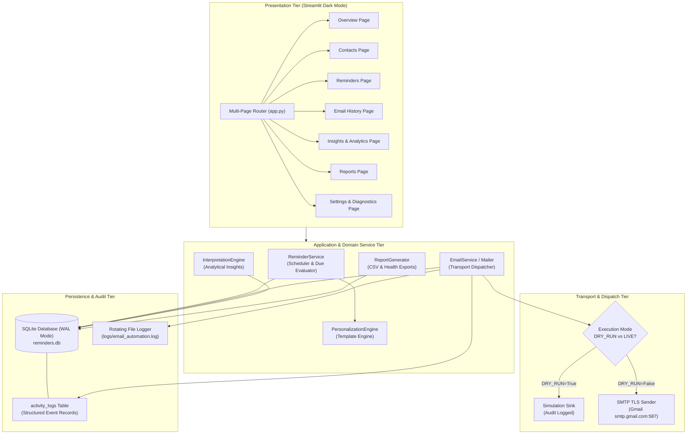
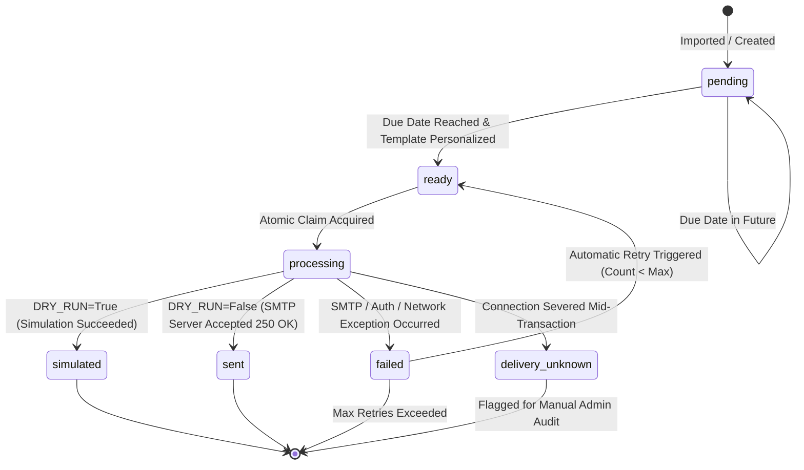

# System Architecture: Email Automation & Reminder System

**Project Name:** Email Automation & Reminder System  
**Author:** Akash Das  
**Development Environment:** Antigravity IDE (VS Code-based)  
**Lead Reviewer & Evaluator:** ChatGPT  
**Implementation Developer:** Antigravity Senior Developer  

---

## 1. High-Level Architectural Overview

The **Email Automation & Reminder System** is built on a modular, multi-tier decoupled architecture designed for high reliability, strict data integrity, zero accidental live email dispatches, and clear operational observability.

The system decouples the presentation tier (Streamlit dark-mode web dashboard) from the core business domain services (personalization, reminder scheduling, mail dispatch, logging, and analytical interpretation), with centralized persistence managed by an ACID-compliant SQLite datastore running in Write-Ahead Logging (WAL) mode.



---

## 2. Multi-Tier Layer Responsibilities

### 2.1 Presentation Tier (`dashboard/`)
The user interface is an interactive web dashboard developed with Streamlit, configured with a permanent, dark-mode visual theme (`#0F172A` background, `#1E293B` cards, `#38BDF8` primary accents). It interacts exclusively with domain services and the SQLite database:

| Component | Responsibility |
| :--- | :--- |
| `dashboard/app.py` | Application entry point, session state initialization, sidebar navigation, dark-mode global styling injection. |
| `dashboard/pages/overview.py` | Executive operational summary: KPI metric cards, status breakdown charts, system activity stream, manual dispatch trigger. |
| `dashboard/pages/contacts.py` | Contact directory: searchable and filterable contact records, detailed contact inspector, associated reminder drill-down. |
| `dashboard/pages/reminders.py` | Reminder operations: due-date filtering, urgency tags, manual reminder creation, preview rendered template modal. |
| `dashboard/pages/email_history.py` | Audit log viewer: chronological email dispatch log, filter by status (`simulated`, `sent`, `failed`, `delivery_unknown`), expandable payload inspector. |
| `dashboard/pages/insights.py` | Phase 11 analytical interpretation engine: workload distribution, department-level rankings, delivery metrics, automated findings cards. |
| `dashboard/pages/reports.py` | Report generation and export: downloadable CSV exports (reminders, contacts, activity logs) and operational summary reports. |
| `dashboard/pages/settings.py` | System diagnostics: environment configuration verification, SQLite integrity check, database table count inspection. |
| `dashboard/components/` | Reusable UI components: `theme.py` (dark CSS tokens), `metrics.py` (KPI cards), `charts.py` (Plotly dark charts), `tables.py` (responsive tables with height sanitization). |

### 2.2 Domain & Application Service Tier (`src/email_automation/`)
Contains all business logic decoupled from presentation:

- **`reminder_service.py` (`ReminderService`)**:
  - Ingests and registers contacts and reminders.
  - Evaluates temporal triggers ($T_{\text{scheduled}} \le T_{\text{current}}$).
  - Transitions records from `pending` to `ready` during due-date checks.
  - Orchestrates automated or manual batch execution.
- **`mailer.py` (`EmailService`)**:
  - Encapsulates email message construction (`MIMEText`, `MIMEMultipart`).
  - Implements the strict two-phase gated dispatch protocol.
  - Manages SMTP network connectivity, authentication, retry logic with exponential backoff, and exception classification.
  - Distinguishes clearly between simulated execution and live SMTP server acceptance.
- **`personalization.py` (`PersonalizationEngine`)**:
  - Loads and validates email templates from `templates/email_templates/`.
  - Performs deterministic placeholder substitution (`{name}`, `{due_date}`, `{task_name}`, `{company}`, etc.).
  - Validates missing placeholders to prevent corrupt outbound messages.
- **`insights.py` (`InterpretationEngine`)**:
  - Computes operational KPIs (delivery success rates, failure ratios, simulation volume).
  - Evaluates workload distribution across time horizons (past-due, due today, upcoming actionable).
  - Generates human-readable automated operational findings and actionable recommendations.
- **`report_generator.py` (`ReportGenerator`)**:
  - Compiles operational summary reports in CSV and dictionary format.
  - Exports complete audit trails for external compliance and record-keeping.

### 2.3 Data Access & Persistence Tier (`src/email_automation/database.py`)
- Centralized SQLite database (`data/database/reminders.db`).
- **Write-Ahead Logging (WAL)**: Enabled via `PRAGMA journal_mode=WAL;` to allow simultaneous readers without blocking writers.
- **Foreign Key Constraints**: Enforced via `PRAGMA foreign_keys=ON;`.
- **Busy Timeout**: Configured to `5000ms` (`PRAGMA busy_timeout=5000;`) to avoid database lock collisions under concurrent Streamlit and CLI access.
- **Schema Migration Engine**: Linear schema versioning (Schema Version 1 through Version 9) allowing safe, idempotent upgrades without data loss.

### 2.4 Infrastructure & Configuration Tier (`src/email_automation/config.py`)
- Reads application configuration from `.env` via `python-dotenv`.
- Enforces strict safety defaults: `DRY_RUN=True` by default to prevent unintended email transmission.
- Manages sensitive SMTP credentials securely outside of source control.

---

## 3. Reminder Lifecycle & Dispatch State Machine

The core reliability of the system stems from its finite state machine. A reminder progresses through well-defined, irreversible states:



### State Definitions
1. **`pending`**: Stored in the database, waiting for scheduled due date/time to arrive.
2. **`ready`**: Due date has arrived, contact data validated, and email template rendered. Ready for dispatch.
3. **`processing`**: Atomic lock acquired by the mailer; prevents duplicate transmission by parallel threads.
4. **`simulated`**: Processed in `DRY_RUN=True` mode; full email payload rendered, validated, and logged to audit trail without touching external networks.
5. **`sent`**: Dispatched via live SMTP (`DRY_RUN=False`) with a `250 OK` acknowledgment code from the remote mail server.
6. **`failed`**: Transmission attempted but rejected by network timeout, authentication error, or invalid recipient address.
7. **`delivery_unknown`**: Transport connection dropped after the `DATA` command but before server response code was received; safely isolated to avoid duplicate sending.

---

## 4. Concurrency & Reliability Design

### 4.1 SQLite Concurrency with WAL
Traditional SQLite in rollback journal mode locks the entire file during write operations. The system configures SQLite with:
```sql
PRAGMA journal_mode = WAL;
PRAGMA synchronous = NORMAL;
PRAGMA busy_timeout = 5000;
PRAGMA foreign_keys = ON;
```
This guarantees:
- Dashboard reader queries (`SELECT`) never block background reminder writes (`UPDATE / INSERT`).
- Long-running analytics queries on the Insights page execute without stalling real-time email dispatch.
- Atomic commit boundaries preserve consistency across process crashes.

### 4.2 Idempotent Two-Phase Gated Dispatch
To prevent double-sending under network retries or concurrent worker threads:
1. **Claim Phase**: An atomic query selects `ready` reminders and flags them as `processing` with a transition timestamp.
2. **Dispatch Phase**: Only reminders holding `processing` status are passed to the SMTP or simulation transport sink.
3. **Commit Phase**: On transport return, status is updated to `sent` or `simulated`. If an unhandled exception occurs, the record transitions to `failed` or `delivery_unknown`—never back to `pending`.

---

## 5. Security & Operational Guardrails

1. **Default Dry-Run Mode**: `DRY_RUN` defaults to `True` in `src/email_automation/config.py`. Live sending requires explicit environment variable override (`DRY_RUN=False`).
2. **App Password Authentication**: Direct user passwords are prohibited; only application-specific passwords (`SMTP_APP_PASSWORD`) are supported.
3. **Secrets Isolation**: `.env`, `.streamlit/secrets.toml`, and sensitive local configs are strictly excluded from version control via `.gitignore`.
4. **Input Sanitization**: Email headers and template variables are sanitized to prevent SMTP header injection attacks (CRLF injection in Subject lines).
5. **No AI Authorship Attribution**: All architectural, engineering, and operational artifacts are authorially credited to **Akash Das**.
