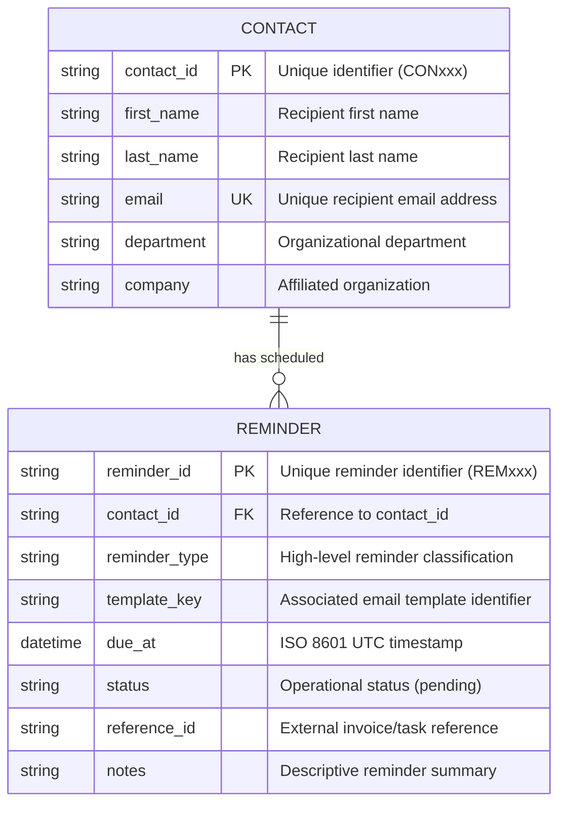

# Dataset Dictionary

**Project Name:** Email Automation & Reminder System  
**Project Author:** Akash Das  
**Development Environment:** Antigravity IDE (VS Code-based)  
**Project Lead & Reviewer:** ChatGPT  

---

## 1. Overview & Purpose
This document provides the technical data dictionary for the sample demonstration datasets used across the **Email Automation & Reminder System**. 

The datasets are stored as CSV files inside [`data/sample/`](file:///d:/Projects/Python/Email%20Automation%20%26%20Reminder%20System/data/sample):
1. [`contacts.csv`](file:///d:/Projects/Python/Email%20Automation%20%26%20Reminder%20System/data/sample/contacts.csv): Contains recipient metadata, company affiliations, and email communication endpoints.
2. [`reminders.csv`](file:///d:/Projects/Python/Email%20Automation%20%26%20Reminder%20System/data/sample/reminders.csv): Contains scheduled reminder tasks, category types, target template references, due dates, and operational states.

> [!NOTE]
> **Fictional Data Declaration**: All names, email addresses, phone records, and organizational affiliations within these datasets are entirely fictional and synthesized exclusively for academic demonstration, portfolio presentation, and system testing. All email addresses use reserved demonstration domains (`example.com`).

---

## 2. Dataset Relationships (Entity-Relationship)

---

## 3. `contacts.csv` Data Dictionary

- **File Path**: `data/sample/contacts.csv`
- **Total Records**: 20
- **Primary Key**: `contact_id`

| Column Name | Data Type | Constraint | Expected Format | Description | Example |
| :--- | :--- | :--- | :--- | :--- | :--- |
| `contact_id` | String | PK, Not Null, Unique | `CON[0-9]{3}` | Unique identifier for each contact entity | `CON001` |
| `first_name` | String | Not Null | Alphabetic | Contact recipient's first name | `Aarav` |
| `last_name` | String | Not Null | Alphabetic | Contact recipient's surname | `Sharma` |
| `email` | String | UK, Not Null, Valid Email | `*@example.com` | Standard email destination address | `aarav.sharma@example.com` |
| `department` | String | Not Null | Enum / Text | Department or functional division | `IT`, `HR`, `Finance`, `Sales` |
| `company` | String | Not Null | Alphanumeric | Organization name | `Apex Innovations` |

---

## 4. `reminders.csv` Data Dictionary

- **File Path**: `data/sample/reminders.csv`
- **Total Records**: 24
- **Primary Key**: `reminder_id`
- **Foreign Key**: `contact_id` $\to$ `contacts.contact_id`

| Column Name | Data Type | Constraint | Expected Format | Description | Example |
| :--- | :--- | :--- | :--- | :--- | :--- |
| `reminder_id` | String | PK, Not Null, Unique | `REM[0-9]{3}` | Unique identifier for each reminder | `REM001` |
| `contact_id` | String | FK, Not Null | `CON[0-9]{3}` | References valid contact in `contacts.csv` | `CON001` |
| `reminder_type`| String | Not Null | Text | Human-readable reminder category | `Task Deadline`, `Meeting` |
| `template_key` | String | Not Null | Enum | Key mapping to email templates | `deadline`, `meeting`, `payment`, `follow_up`, `general` |
| `due_at` | DateTime | Not Null, Timezone-aware | ISO 8601 UTC (`YYYY-MM-DDTHH:MM:SSZ`) | Target execution or deadline timestamp | `2027-01-10T10:00:00Z` |
| `status` | String | Not Null | Enum (`pending`) | Initial operational workflow state | `pending` |
| `reference_id` | String | Optional / Not Null | Alphanumeric | Associated document or tracking code | `TSK-1001`, `INV-3001` |
| `notes` | String | Not Null | Text | Human-readable instruction or detail | `Submit Q1 cloud infrastructure upgrade plan` |

---

## 5. Validation & Integrity Constraints
1. **Uniqueness**:
   - Every `contact_id` in `contacts.csv` is globally unique.
   - Every `email` in `contacts.csv` is unique (no duplicate recipients).
   - Every `reminder_id` in `reminders.csv` is globally unique.
2. **Referential Integrity**:
   - Every `contact_id` in `reminders.csv` must resolve to an existing `contact_id` in `contacts.csv`.
3. **Temporal Validity**:
   - All `due_at` timestamps must be valid, parseable ISO 8601 UTC timestamps ending with `Z`.
   - Dates are set in 2027 to provide an extended demonstration horizon.
4. **State Consistency**:
   - All records initialize with `status == "pending"`.
   - `template_key` values strictly conform to the five core templates: `deadline`, `meeting`, `payment`, `follow_up`, `general`.
