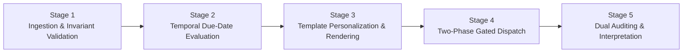
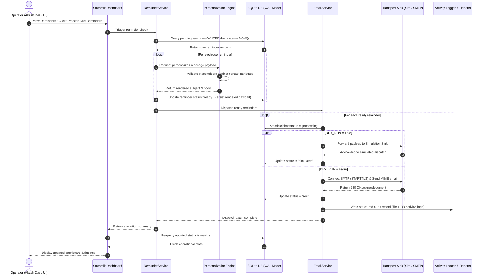

# Data Flow & Execution Pipeline: Email Automation & Reminder System

**Project Name:** Email Automation & Reminder System  
**Author:** Akash Das  
**Development Environment:** Antigravity IDE (VS Code-based)  
**Lead Reviewer & Evaluator:** ChatGPT  
**Implementation Developer:** Antigravity Senior Developer  

---

## 1. End-to-End Pipeline Overview

The **Email Automation & Reminder System** processes data across five distinct, sequential lifecycle stages. Every data entity undergoes schema validation, state validation, and audit recording before moving to the next stage.



---

## 2. Comprehensive Pipeline Sequence



---

## 3. Data Transformation Stages & Schemas

### Stage 1: Data Ingestion & Invariant Validation
Raw contact and reminder records are imported from CSV files or entered via the Streamlit UI into normalized SQLite tables.

**Ingested Contact Record Schema:**
```json
{
  "contact_id": "CON001",
  "name": "Aarav Sharma",
  "email": "aarav.sharma@example.com",
  "department": "Engineering",
  "company": "Apex Innovations",
  "created_at": "2026-11-21T19:27:51.232781+00:00"
}
```

**Ingested Reminder Record Schema:**
```json
{
  "reminder_id": "REM001",
  "contact_id": "CON001",
  "title": "Quarterly Code Audit Review",
  "due_date": "2027-01-15T10:00:00",
  "priority": "high",
  "category": "Audit",
  "template_name": "task_reminder.txt",
  "status": "pending",
  "retry_count": 0
}
```

**Invariants Enforced:**
- Email addresses must conform to RFC 5322 regex validation.
- `due_date` strings must parse into valid ISO 8601 timestamps.
- `contact_id` must satisfy foreign key constraints referencing an existing contact.

---

### Stage 2: Temporal Due-Date Evaluation
The scheduling engine polls SQLite using parameterized SQL:
```sql
SELECT * FROM reminders 
WHERE status = 'pending' 
  AND datetime(due_date) <= datetime('now')
ORDER BY due_date ASC;
```
- Reminders whose scheduled time has not yet arrived remain in `pending` status.
- Reminders matching the criteria are marked for rendering.

---

### Stage 3: Template Personalization & Rendering
The `PersonalizationEngine` merges reminder context with contact metadata:

**Template Source (`templates/email_templates/task_reminder.txt`):**
```text
Subject: Action Required: {task_name} Due Soon

Dear {name},

This is a reminder regarding your scheduled task: "{task_name}".
Deadline: {due_date}
Priority Level: {priority}

Please let us know once completed.

Best regards,
{company} Automated Reminder System
```

**Merged Context Dictionary:**
```json
{
  "name": "Aarav Sharma",
  "task_name": "Quarterly Code Audit Review",
  "due_date": "January 15, 2027 at 10:00 AM",
  "priority": "HIGH",
  "company": "Apex Innovations"
}
```

**Validation Checks:**
- All `{placeholders}` in the template must be present in the context dictionary.
- If any required placeholder is missing, a `MissingPlaceholderError` is raised, logged, and the reminder remains unrendered rather than emitting a malformed email.
- Upon successful rendering, the reminder transitions to `status = 'ready'`.

---

### Stage 4: Two-Phase Gated Dispatch
To guarantee idempotency and avoid double-sends in concurrent environments:

1. **Claim Phase**:
   ```sql
   UPDATE reminders 
   SET status = 'processing', updated_at = CURRENT_TIMESTAMP 
   WHERE reminder_id = :id AND status = 'ready';
   ```
2. **Transport Gating**:
   - If `DRY_RUN = True`:
     - Email payload is constructed as a full `MIMEText` message.
     - Payload is verified and routed to the internal simulation sink.
     - Reminder status is updated to `simulated`.
   - If `DRY_RUN = False`:
     - TLS connection established with `smtp.gmail.com:587`.
     - Credentials authenticated via Google App Password.
     - `send_message()` executes.
     - Upon `250 OK`, reminder status is updated to `sent`.
3. **Failure Handling**:
   - Connection or timeout failures increment `retry_count` and log the error stack.
   - If `retry_count < MAX_RETRIES`, reminder resets to `ready` for next cycle.
   - If `retry_count >= MAX_RETRIES`, reminder transitions permanently to `failed`.
   - Ambiguous connection drops transition to `delivery_unknown` for human review.

---

### Stage 5: Dual Auditing & Analytical Interpretation
Every dispatch event generates dual persistence artifacts:

1. **Structured Log File (`logs/email_automation.log`)**:
   ```text
   2026-11-22 16:40:12 [INFO] mailer: SIMULATED dispatch for REM001 to aarav.sharma@example.com (Subject: Action Required: Quarterly Code Audit Review Due Soon)
   ```

2. **Database Activity Record (`activity_logs` table)**:
   ```json
   {
     "log_id": 142,
     "timestamp": "2026-11-22T16:40:12+00:00",
     "event_type": "email_dispatched",
     "severity": "INFO",
     "reminder_id": "REM001",
     "contact_id": "CON001",
     "status": "simulated",
     "message": "Simulated dispatch succeeded (Dry-Run mode active)",
     "details": "{\"transport\": \"simulation\", \"recipient\": \"aarav.sharma@example.com\"}"
   }
   ```

3. **Analytical Interpretation Engine**:
   - `InterpretationEngine` queries `activity_logs` and `reminders` to evaluate:
     - Realized delivery success rates ($\frac{\text{Simulated} + \text{Sent}}{\text{Attempted}} \times 100\%$).
     - Upcoming actionable workload ($T_{\text{due}} > \text{NOW}$ with status `pending` or `ready`).
     - Departmental workload concentration (e.g., Engineering vs Marketing).
   - Generates real-time findings cards displayed on the Streamlit dashboard.
