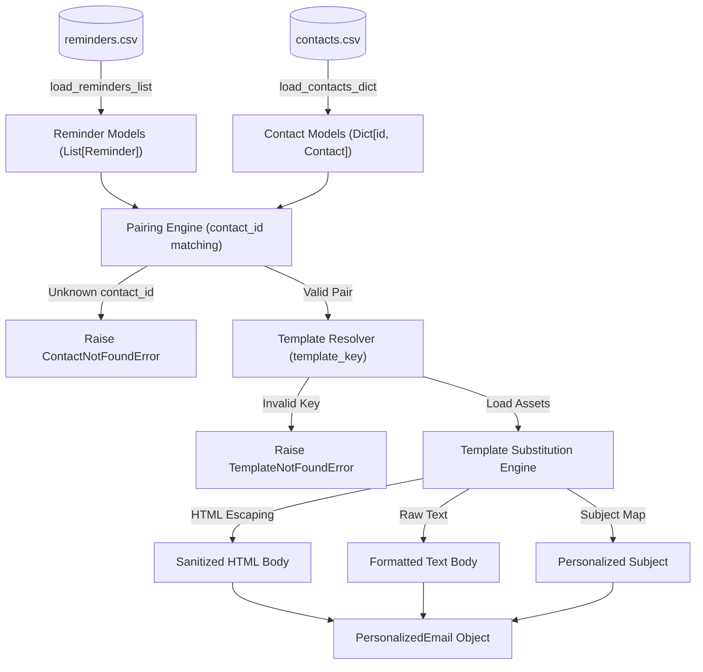

# Email Personalization Architecture & Guide

**Project Name:** Email Automation & Reminder System  
**Project Author:** Akash Das  
**Development Environment:** Antigravity IDE (VS Code-based)  
**Project Lead & Reviewer:** ChatGPT  

---

## 1. Overview & Purpose
The **Email Personalization Engine** (`src/email_automation/personalization.py`) is responsible for dynamically assembling customized email payloads by pairing individual contact records from [`data/sample/contacts.csv`](file:///d:/Projects/Python/Email%20Automation%20%26%20Reminder%20System/data/sample/contacts.csv) with scheduled reminder tasks from [`data/sample/reminders.csv`](file:///d:/Projects/Python/Email%20Automation%20%26%20Reminder%20System/data/sample/reminders.csv), applying the appropriate template from [`templates/email_templates/`](file:///d:/Projects/Python/Email%20Automation%20%26%20Reminder%20System/templates/email_templates), and generating fully rendered HTML and plain-text message bodies with personalized subjects.

---

## 2. Personalization Workflow Architecture



---

## 3. Contact & Reminder Pairing
- **Matching Key**: Each reminder is matched via `reminder.contact_id == contact.contact_id`.
- **Integrity Enforcement**: If a reminder references a nonexistent contact, the engine raises a `ContactNotFoundError` preventing corrupted or orphaned dispatches.
- **Data Safety**: All source CSV datasets are read-only. Source files remain bit-for-bit unchanged.

---

## 4. Template Selection & Subject Generation

### Template Key Mapping
| Template Key | HTML File | Text File | Subject Format |
| :--- | :--- | :--- | :--- |
| `meeting` | `meeting_reminder.html` | `meeting_reminder.txt` | `Meeting Reminder: {notes} [Ref: #{reference_id}]` |
| `payment` | `payment_reminder.html` | `payment_reminder.txt` | `Payment Notice: Upcoming payment for invoice #{reference_id}` |
| `deadline` | `deadline_reminder.html` | `deadline_reminder.txt` | `Deadline Reminder: Action required for {notes} [Ref: #{reference_id}]` |
| `follow_up` | `follow_up_reminder.html` | `follow_up_reminder.txt` | `Follow-Up Request: Status update regarding {notes} [Ref: #{reference_id}]` |
| `general` | `general_reminder.html` | `general_reminder.txt` | `Notice: {reminder_type} update for {company} - Ref: #{reference_id}` |

---

## 5. Placeholder Substitution & Security

### Template-Specific Placeholder Validation
The engine parses individual template files and **only validates the placeholders that each specific template actually uses**. A template requiring `{first_name}` and `{notes}` does not fail simply because other global placeholders (such as `{reminder_type}`) are omitted.

### HTML Injection Prevention
All user-controlled strings (e.g., contact names, notes, company titles) are sanitized through `html.escape(value, quote=True)` prior to interpolation into HTML templates. Plain-text bodies retain the native string format without HTML entity encoding.

---

## 6. Output Data Structure (`PersonalizedEmail`)

```python
@dataclass(frozen=True)
class PersonalizedEmail:
    reminder_id: str
    contact_id: str
    recipient_email: str
    recipient_name: str
    template_key: str
    subject: str
    html_body: str
    text_body: str
    due_at: str
    reference_id: str
```

---

## 7. How to Run the Automated Test Suite

From the repository root using `.venv`:
```powershell
.\.venv\Scripts\Activate.ps1
pytest tests/test_personalization.py -v
```

---

## 8. Example Personalized Output (Fictional Sample Data)

- **Reminder ID**: `REM001`
- **Recipient Email**: `aarav.sharma@example.com`
- **Recipient Name**: `Aarav Sharma`
- **Template Key**: `deadline`
- **Subject**: `Deadline Reminder: Action required for Submit Q1 cloud infrastructure upgrade plan [Ref: #TSK-1001]`

#### Plain-Text Body:
```text
Hello Aarav,

This is an automated deadline reminder for an assigned milestone: Submit Q1 cloud infrastructure upgrade plan.

TASK DETAILS:
- Deliverable: Submit Q1 cloud infrastructure upgrade plan
- Deadline: 2027-01-10T10:00:00Z
- Task Tracking ID: TSK-1001
- Department: IT
- Company: Apex Innovations

Please review the deliverables and complete the submission prior to the deadline. If you foresee any obstacles or require team assistance, please escalate to your project coordinator.

Regards,
Apex Innovations Project Management Office

---
Deadline notice sent to Aarav Sharma (aarav.sharma@example.com) | Ref: TSK-1001
```
