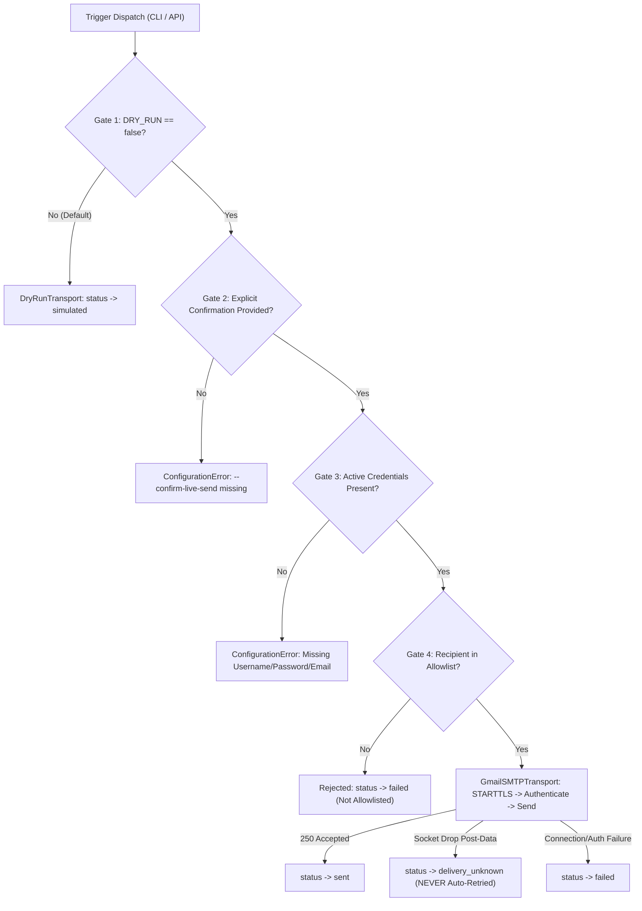
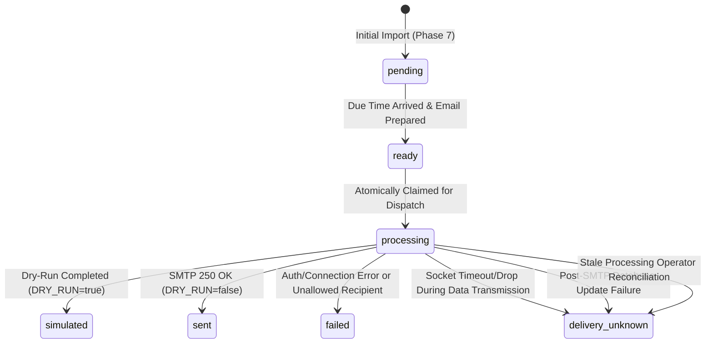

# Email Sending Architecture & Dispatch Guide

**Project Name:** Email Automation & Reminder System  
**Project Author:** Akash Das  
**Development Environment:** Antigravity IDE (VS Code-based)  
**Project Lead & Reviewer:** ChatGPT  

---

## 1. Overview & Purpose

The **Email Sending Subsystem** (`src/email_automation/mailer.py`) consumes staged email records prepared in Phase 7 and securely dispatches them according to strict dual-mode operational rules:

1. **Dry-Run Simulation (Default & Safe Mode)**: Exercises the complete claiming, database state transition, payload inspection, and MIME generation pipeline without opening network sockets or connecting to external SMTP servers. Records are transitioned to status `simulated`.
2. **Live Gmail SMTP Delivery**: Authorizes live message delivery over secure TLS (STARTTLS on port 587) only when four distinct safety gates are simultaneously satisfied. Records accepted by the remote SMTP server transition to status `sent`.

---

## 2. Core Safety Architecture & Four-Gate Live Sending Protocol

To prevent accidental email transmission during local development, automated testing, or demonstration, the dispatch engine enforces a strict **fail-closed** architecture:



### The Four Safety Gates
1. **Environment Flag (`DRY_RUN=false`)**: Configured explicitly in `.env`.
2. **Explicit User Authorization (`confirm_live_send=True`)**: Must be explicitly supplied via `--confirm-live-send` on the CLI or `confirm_live_send=True` programmatically.
3. **Active Credential Assertion**: `SMTP_USERNAME`, `SMTP_PASSWORD`, and `EMAIL_FROM` must be present and valid strings.
4. **Recipient Allowlist (`SMTP_ALLOWED_RECIPIENTS`)**:
   - Live delivery will **only** send to email addresses explicitly listed in the `SMTP_ALLOWED_RECIPIENTS` environment variable (comma-separated).
   - If `SMTP_ALLOWED_RECIPIENTS` is empty (the default configuration in `.env.example`), all outgoing emails in live mode are rejected with a terminal `failed` status and logged safety notice.

---

## 3. MIME Message Construction

The `build_mime_message()` factory converts a `PersonalizedEmail` domain model into a standard RFC 5322 MIME message:
- **Type**: `multipart/alternative` containing both:
  - `text/plain; charset=utf-8` (fallback for terminal clients and accessibility readers)
  - `text/html; charset=utf-8` (styled HTML body with responsive layouts)
- **Standard Headers**:
  - `Subject`: Formatted dynamic subject line
  - `From`: RFC 2822 display name and address (`Akash Das <sender@gmail.com>`)
  - `To`: Target recipient address
  - `Date`: Generated RFC 2822 timestamp (`email.utils.formatdate(localtime=True)`)
  - `Message-ID`: Unique cryptographic identifier (`email.utils.make_msgid()`)

---

## 4. Status Lifecycle & Database State Machine



### Complete State Definitions:
- `pending`: Awaiting scheduled `due_at` timestamp.
- `ready`: Personalized email rendered and stored in `prepared_emails`.
- `processing`: Atomically claimed by an active dispatch worker; locked against concurrent workers.
- `simulated`: Safe execution in dry-run mode. Zero network activity occurred.
- `sent`: Successfully accepted by Gmail SMTP server for delivery.
- `failed`: Terminal transmission failure (e.g., DNS error, invalid credentials, recipient rejected). Recorded with `dispatch_error`.
- `delivery_unknown`: Ambiguous network failure or post-send database failure. **Never automatically retried.**

---

## 5. Processing-State Crash Recovery & Manual Reconciliation

If the application crashes, loses power, or is abruptly terminated while a record is in `status = 'processing'`:
1. **Zero Automated Re-Execution**: The continuous scheduler (`run_due_reminders_once()`) claims only `pending` records; the mailer (`claim_ready_emails_for_dispatch()`) claims only `ready` records. Neither will ever touch a record stranded in `processing`.
2. **Detection**: Operators inspect stranded records via `python main.py list-stale` or `get_stale_processing_reminders()`.
3. **Safe Reconciliation**: Operators run `python main.py reconcile-stale` (`reconcile_stale_processing_records()`), which by default transitions records safely to `delivery_unknown` (or `failed`) with an explanatory audit trail.
4. **Safety Assertion**: Transitioning a stranded record back to `ready` raises a `ValueError` unless `allow_ready_retry=True` is explicitly set, preventing operators from accidentally causing duplicate emails.

---

## 6. Database Failure After SMTP Acceptance Handling

An external SMTP network dispatch and an internal SQLite database write cannot form an atomic two-phase commit transaction without distributed transaction coordinators.

If `GmailSMTPTransport.send()` receives SMTP `250 OK`, the message has been permanently delivered to Gmail's message queue. If `update_dispatch_outcome(..., "sent")` subsequently fails (e.g. disk full, lock timeout):
1. The dispatcher catches the database exception.
2. It attempts a secondary update to mark the record `delivery_unknown` with a critical error message explaining that SMTP accepted the message but the database write to `sent` failed.
3. If even the secondary database update fails, the record remains in `status = 'processing'`.
4. **Anti-Duplication Guarantee**: Under no circumstances is the record reverted to `ready` or marked retryable. It is permanently excluded from future dispatch cycles.

---

## 7. Database Schema Migration Architecture (Phase 7 to Phase 8)

In SQLite, changing `CREATE TABLE` statements does not modify existing tables or alter table `CHECK` constraints. When upgrading an existing Phase 7 database:
1. `migrate_db()` detects if `dispatch_error` column is absent or if `'simulated'`/`'delivery_unknown'` are missing from the `reminders` table definition.
2. It executes a foreign-key-safe table upgrade pattern:
   - Sets `PRAGMA foreign_keys = OFF;`
   - Creates `_reminders_phase8` table with the full Phase 8 schema and expanded `CHECK(status IN (...))` constraint.
   - Copies all existing records across, assigning `NULL` for `dispatch_error`.
   - Drops legacy `reminders` table.
   - Renames `_reminders_phase8` to `reminders`.
   - Recreates performance index `idx_reminders_status_due`.
   - Records schema version `8` in `schema_version`.
   - Restores `PRAGMA foreign_keys = ON;` and executes `PRAGMA foreign_key_check;`.
3. **Complete Data Preservation**: 100% of contacts, reminders, prepared email records, statuses, and HTML/text bodies are preserved without loss.

---

## 8. SMTP Result Classification Matrix

Exceptions in `GmailSMTPTransport.send()` are strictly classified without broad assumptions:

| Exception Class | Trigger Condition | Outcome Status | Retryable? |
| :--- | :--- | :--- | :---: |
| `SMTPAuthenticationError` | Bad credentials or revoked app password | `failed` | No |
| `SMTPConnectError` | Cannot reach host before connection setup | `failed` | No |
| `SMTPRecipientsRefused` | Recipient email rejected by SMTP server | `failed` | No |
| `SMTPSenderRefused` | From address rejected by SMTP server | `failed` | No |
| `SMTPDataError` | Message body rejected during DATA command | `failed` | No |
| `SMTPResponseException` | Other 5xx definitive rejection codes | `failed` | No |
| `SMTPServerDisconnected` (post-DATA) | Connection dropped after transmission started | `delivery_unknown` | **NEVER** |
| `socket.timeout` (post-DATA) | Timed out waiting for `250 OK` after transmission started | `delivery_unknown` | **NEVER** |
| `socket.timeout` / `OSError` (pre-DATA) | Connect / TLS handshake failure | `failed` | No |

---

## 9. CLI Commands & Management

```powershell
# 1. Preview ready emails in SQLite
python main.py list-prepared

# 2. Dispatch ready emails via safe dry-run simulation (Default)
python main.py send-ready

# 3. Dispatch with batch limit
python main.py send-ready --limit 5

# 4. Live SMTP dispatch (Requires DRY_RUN=false in .env and explicit confirmation)
python main.py send-ready --confirm-live-send

# 5. List any reminders stranded in 'processing' status
python main.py list-stale

# 6. Reconcile stranded processing records after unexpected crash
python main.py reconcile-stale --target-status delivery_unknown

# 7. Upgrade database schema from Phase 7 to Phase 8
python main.py migrate-db
```

---

## 10. Automated Test Coverage

The test suite in `tests/test_mailer.py` covers 23 comprehensive tests with 100% pass rate:
- Zero socket connections during dry-run.
- Refusal of live sending when credentials are missing or incomplete.
- Refusal of live sending when CLI confirmation is omitted.
- Refusal of live sending when recipient allowlist is empty.
- Rejection of unauthorized recipients not on allowlist.
- Successful transmission to allowlisted recipients (mocked transport).
- Verification that `STARTTLS` is invoked before authentication.
- Verification of MIME structure (`multipart/alternative`), text, and HTML parts.
- Verification of `From`, `To`, `Subject`, `Date`, and `Message-ID` headers.
- Safe handling of `SMTPAuthenticationError` without credential leaks.
- Definite connection failures transitioned to `failed`.
- Ambiguous socket drops marked `delivery_unknown` and excluded from retries.
- Concurrency isolation: multiple workers claiming records without duplicates.
- Database state consistency and rollback safety.
- Complete credential sanitization in all logs and exception messages.
- Dispatch summary metric accuracy.
- Interrupted processing crash recovery and discovery.
- Database failure handling after SMTP acceptance (`delivery_unknown`).
- Lossless Phase 7 to Phase 8 schema migration with foreign key validation.
- SMTP result classification matrix covering connection, auth, rejection, and timeout.
- Permanent exclusion of ambiguous records (`delivery_unknown`, `processing`) from automated retry.
