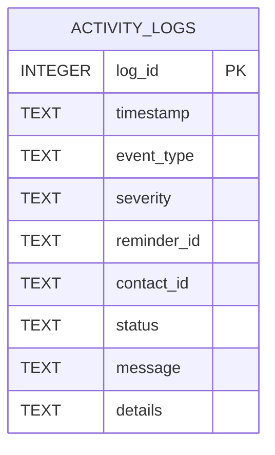

# Logging & Report Generation Guide

**Project Name:** Email Automation & Reminder System  
**Project Author:** Akash Das  
**Development Environment:** Antigravity IDE (VS Code-based)  
**Project Lead & Reviewer:** ChatGPT  

---

## 1. Overview & Purpose

The **Logging & Report Generation Subsystem** (`src/email_automation/logger.py` and `src/email_automation/report_generator.py`) provides structured operational observability, persistent audit history, and validated CSV report exports.

The subsystem strictly adheres to enterprise audit standards:
- **Zero Mock / Synthetic Metrics**: Reports reflect actual database records and runtime executions only.
- **Data Privacy & Redaction**: Credentials, SMTP passwords, and raw HTML bodies are never written to logs or exported in CSV reports.
- **Fail-Soft Isolation**: Logging failures never roll back or corrupt outer reminder workflows or email dispatch transactions.
- **CSV Formula Injection Protection**: All user-controlled text cells beginning with spreadsheet formula triggers (`=`, `+`, `-`, `@`, `\t`, `\r`) are safely escaped with a leading single quote (`'`) during export without altering underlying SQLite database records.
- **Inclusive UTC Boundaries**: Date-range filtering operates strictly in UTC with inclusive start and end boundaries (`YYYY-MM-DDT00:00:00Z` to `YYYY-MM-DDT23:59:59Z`).
- **Streamlit Decoupling**: Fully functional via Python API and command-line interface without Streamlit dependencies (ready for Phase 10 UI integration).

---

## 2. Centralized Application Logging

Implemented in `src/email_automation/logger.py`:

```text
[ Application Event ] ──> setup_logging() ──┬──> StreamHandler (Console stdout)
                                            └──> FileHandler (logs/email_automation.log)
```

### Key Technical Attributes:
- **Standard Library Foundation**: Built directly on Python's built-in `logging` module.
- **Consistent Log Format**: `%(asctime)s | %(levelname)-8s | %(name)s | %(message)s` with ISO timestamps (`%Y-%m-%dT%H:%M:%S%z`).
- **Severity Levels**: `INFO`, `WARNING`, `ERROR`, `CRITICAL`, and `DEBUG`.
- **Duplicate Handler Prevention**: Handlers are deduplicated on re-initialization.
- **Default Storage Location**: `logs/email_automation.log` (UTF-8 encoded).

### Event Instrumentation Across Modules:
- **Startup / Shutdown**: CLI command invocations (`app_startup`, `app_shutdown`).
- **Database**: Table initialization (`database_initialized`) and schema migration (`database_migrated`).
- **Data Synchronization**: Synchronized contact and reminder counts (`data_synced`).
- **Scheduler**: Scheduler loop start, cycle check, and stop (`scheduler_started`, `scheduler_cycle`, `scheduler_stopped`).
- **Personalization**: Successful template staging (`reminder_prepared`) and placeholder resolution failures (`reminder_preparation_failed`).
- **Email Dispatch**: Batch claims (`dispatch_batch_started`), simulated dry-run outcomes (`email_simulated`), remote SMTP acceptances (`email_smtp_accepted`), connection failures (`email_failed`), ambiguous states (`email_delivery_unknown`), and batch completion (`dispatch_batch_completed`).
- **Recovery Operations**: Stale `processing` record detection and reconciliation (`stale_dispatch_reconciled`).
- **Report Exports**: Successful CSV report generations (`report_generated`) and failures (`report_generation_failed`).

---

## 3. Persistent Activity History (`activity_logs`)

The persistent audit trail is managed via SQLite in `data/database/reminders.db`:



### Table Schema & Index Architecture:
```sql
CREATE TABLE IF NOT EXISTS activity_logs (
    log_id INTEGER PRIMARY KEY AUTOINCREMENT,
    timestamp TEXT NOT NULL,
    event_type TEXT NOT NULL,
    severity TEXT NOT NULL,
    reminder_id TEXT,
    contact_id TEXT,
    status TEXT NOT NULL,
    message TEXT NOT NULL,
    details TEXT
);

CREATE INDEX IF NOT EXISTS idx_activity_logs_ts ON activity_logs (timestamp);
CREATE INDEX IF NOT EXISTS idx_activity_logs_event ON activity_logs (event_type);
CREATE INDEX IF NOT EXISTS idx_activity_logs_severity ON activity_logs (severity);
CREATE INDEX IF NOT EXISTS idx_activity_logs_reminder ON activity_logs (reminder_id);
CREATE INDEX IF NOT EXISTS idx_activity_logs_status ON activity_logs (status);
```

### Standardized Event Taxonomy:
| Event Type | Typical Severity | Trigger Condition |
| :--- | :---: | :--- |
| `app_startup` | `INFO` | CLI invocation initiated |
| `app_shutdown` | `INFO` | CLI command completed |
| `database_initialized` | `INFO` | SQLite tables and indexes initialized/verified |
| `database_migrated` | `INFO` | Database schema safely upgraded |
| `data_synced` | `INFO` | Contact & reminder CSV records synchronized into SQLite |
| `scheduler_started` | `INFO` | Continuous scheduler loop started |
| `scheduler_cycle` | `INFO` | Periodic scheduler evaluation completed |
| `scheduler_stopped` | `INFO` | Scheduler loop terminated |
| `reminder_prepared` | `INFO` | Reminder reached due timestamp and email staged in `prepared_emails` |
| `reminder_preparation_failed` | `ERROR` | Personalization or missing contact lookup failure |
| `dispatch_batch_started` | `INFO` | Dispatcher claimed ready emails into `processing` status |
| `email_simulated` | `INFO` | Dry-run message simulated without network socket creation |
| `email_smtp_accepted` | `INFO` | Gmail SMTP server accepted message (`250 OK`) |
| `email_failed` | `ERROR` | Definitive dispatch failure (bad credentials, recipient not allowlisted) |
| `email_delivery_unknown` | `CRITICAL` | Ambiguous outcome (socket drop post-DATA or post-send DB error) |
| `dispatch_batch_completed` | `INFO` | Batch email dispatch run completed |
| `stale_dispatch_reconciled` | `WARNING` | Stranded `processing` record transitioned by operator |
| `report_generated` | `INFO` | CSV report exported to `outputs/reports/` |
| `report_generation_failed` | `ERROR` | Failure encountered while generating CSV report |

---

## 4. Report Generation Engine

Implemented in `src/email_automation/report_generator.py`. Outputs are saved with timestamped filenames in `outputs/reports/`.

### A. Email Activity Report
- **Function**: `generate_email_activity_report(db_path, output_dir, start_date, end_date)`
- **Data Source**: Join of `reminders`, `contacts`, and `prepared_emails`.
- **Scope Restriction**: Strictly includes records representing actual dispatch attempts (`simulated`, `sent`, `failed`, `delivery_unknown`). Non-attempted reminders (`pending`, `ready`, `processing`) are strictly excluded.
- **Columns**:
  1. `reminder_id`: Unique identifier of the reminder.
  2. `contact_id`: Associated contact reference.
  3. `recipient_email`: Recipient email address.
  4. `template_key`: Template key (`meeting`, `payment`, `deadline`, etc.).
  5. `subject`: Dynamic subject line generated during personalization.
  6. `due_at`: Scheduled UTC due timestamp.
  7. `dispatch_status`: Dispatch outcome status (`simulated`, `sent`, `failed`, `delivery_unknown`).
  8. `prepared_timestamp`: Timestamp when personalization and queue insertion succeeded.
  9. `dispatch_timestamp`: Timestamp when transport outcome was recorded in SQLite.
  10. `safe_failure_reason`: Error description if dispatch failed (empty if success).

### B. Required Reminder Status Count Report
- **Function**: `generate_reminder_status_report(db_path, output_dir)`
- **Data Source**: Real-time aggregated status counts from `reminders` table.
- **Columns**: `status`, `count`, `display_name`, `description`.
- **Status Categories Exported**:
  1. `pending`: Reminders awaiting scheduled due timestamp.
  2. `ready`: Reminders prepared and staged for dispatch.
  3. `processing`: Reminders actively claimed by transport worker.
  4. `simulated`: Reminders dispatched via safe dry-run simulation.
  5. `sent`: Messages accepted by Gmail SMTP (remote acceptance; not confirmed delivery).
  6. `failed`: Definitive dispatch failures recorded with error details.
  7. `delivery_unknown`: Ambiguous transmission outcomes quarantined from automatic retry.
  8. `total`: Total registered reminder records across all states.
  9. `attempted`: Total dispatch attempts (`simulated + sent + failed`).
  10. `success_rate`: Ratio of accepted/simulated outcomes to total attempts.
- **Calculation Invariants**:
  $$\text{Attempted} = \text{Simulated} + \text{SMTP Accepted} + \text{Failed}$$
  - Pending, ready, and processing are **strictly excluded** from the attempted denominator.
  - `delivery_unknown` is excluded from the success-rate denominator and maintained as a separate operational count.
  - `simulated` and `smtp_accepted` counts remain strictly separate.
  - Remote SMTP acceptance is explicitly documented as remote acceptance, not guaranteed inbox delivery.
  $$\text{Success Rate} = \frac{\text{Simulated} + \text{SMTP Accepted}}{\text{Attempted}} \times 100\% \quad (\text{if } \text{Attempted} > 0 \text{ else } 0.0\%)$$

### C. Optional Detailed Reminder Snapshot Report
- **Function**: `generate_reminder_details_report(db_path, output_dir)`
- **Data Source**: `reminders` table joined with `contacts`.
- **Columns**: `reminder_id`, `contact_id`, `contact_name`, `company`, `recipient_email`, `reminder_type`, `template_key`, `due_at`, `status`, `reference_id`, `notes`, `created_at`, `updated_at`.

### D. Activity History Report
- **Function**: `generate_activity_history_report(db_path, output_dir, start_date, end_date, event_type, severity, status)`
- **Data Source**: `activity_logs` table.
- **Columns**: `log_id`, `timestamp`, `event_type`, `severity`, `reminder_id`, `contact_id`, `status`, `message`, `details`.

---

## 5. CSV Formula Injection Protection

Spreadsheet applications (Microsoft Excel, LibreOffice Calc, Google Sheets) execute text cells starting with formula trigger characters as formulas.

The system mitigates formula injection via `sanitize_csv_value()`:
```python
FORMULA_PREFIXES = ("=", "+", "-", "@", "\t", "\r")

def sanitize_csv_value(value: Any) -> Any:
    if value is None:
        return ""
    if isinstance(value, str):
        if value.startswith(FORMULA_PREFIXES):
            return f"'{value}"
        return value
    return value
```

### Safety Invariants:
1. All user-controlled text cells (email, subject, notes, company, message, details) pass through `sanitize_csv_value()`.
2. Dangerous characters at the start of text are prefixed with `'` in the CSV file.
3. Original database values in SQLite are **never modified**.

---

## 6. CLI Usage & Commands

```powershell
# 1. View recent activity history events in console
python main.py show-activity --limit 20

# 2. Filter activity events by event type or severity
python main.py show-activity --event-type email_failed --severity ERROR

# 3. Generate Email Activity Report (CSV)
python main.py generate-report --type email-activity

# 4. Generate Email Activity Report with Date-Range Filter (Inclusive UTC)
python main.py generate-report --type email-activity --start-date 2026-01-01 --end-date 2026-12-31

# 5. Generate Required Reminder Status Count Report
python main.py generate-report --type reminder-status

# 6. Generate Optional Detailed Reminder Snapshot Report
python main.py generate-report --type reminder-details

# 7. Generate Activity History Audit Report
python main.py generate-report --type activity-history

# 8. Generate All Reports Simultaneously
python main.py generate-report --type all
```

---

## 7. Database Migration (Phase 8 & Earlier Phase 9 to Final Phase 9)

`migrate_db()` in `src/email_automation/database.py` handles lossless version upgrades from both Phase 8 and earlier Phase 9 schemas:
1. Detects `schema_version` and validates `activity_logs` table structure.
2. If `activity_logs` does not exist or has outdated columns (such as the earlier Phase 9 schema containing `id`, `details_json`, and lacking `status`/`message`), it safely migrates all historical records:
   - Maps `id` to `log_id`.
   - Maps `details_json` to `details`.
   - Infers or assigns honest, safe values for `status` (`ready`, `simulated`, `sent`, `failed`, `delivery_unknown`, or `'recorded'`).
   - Populates `message` safely.
3. Upgrades/creates `activity_logs` with all 9 fields: `log_id`, `timestamp`, `event_type`, `severity`, `reminder_id`, `contact_id`, `status`, `message`, `details`.
4. Creates five B-tree indexes (`idx_activity_logs_ts`, `idx_activity_logs_event`, `idx_activity_logs_severity`, `idx_activity_logs_reminder`, `idx_activity_logs_status`).
5. Updates `schema_version` to version `9`.
6. Executes `PRAGMA foreign_key_check;` to confirm zero foreign key violations.
7. **Data Integrity Guarantee**: Existing `contacts`, `reminders`, `prepared_emails`, statuses, and `dispatch_error` records are 100% preserved.
8. Subsequent calls to `migrate_db()` are strictly idempotent (return `False`).

---

## 8. Automated Test Coverage

The test suite in `tests/test_logging_reporting.py` provides 25 dedicated tests with 100% pass rate:
- Logger initialization with custom levels and formatters.
- Duplicate logger handler prevention across multiple imports.
- File log persistence in nested directories.
- Console logging via StreamHandler.
- SQLite `activity_logs` table and 5-index verification.
- Complete 9-column schema inspection for `activity_logs`.
- Event persistence across connections.
- Parameterized event filtering by type, severity, status, and timestamps.
- Fail-soft behavior for activity logging on error.
- Sensitive credential and password masking in logs and activity records.
- CSV generation and schema verification for email activity reports with explicit timestamps.
- Restriction of Email Activity Report strictly to actual dispatch attempts (`simulated`, `sent`, `failed`, `delivery_unknown`).
- CSV generation and metric verification for reminder status count reports covering all 7 statuses.
- Detailed reminder snapshot report export.
- CSV generation for activity history reports.
- Graceful handling of empty databases with intact CSV headers.
- Inclusive UTC date-range filtering on exact boundaries.
- UTF-8 encoding compliance across all exports.
- CSV formula injection protection (verifying leading `'` in CSV and unaltered DB values).
- Verification that attempted denominator = simulated + sent + failed (excluding pending, ready, processing, delivery_unknown).
- Distinct separation of simulated vs SMTP-accepted outcomes.
- Verification that report generation is strictly read-only and does not alter reminder statuses.
- Comprehensive lossless Phase 8 to Phase 9 database schema migration and foreign key validation.
- Safe migration from earlier Phase 9 schema with historical data preservation and field mapping.
- Complete activity-event instrumentation across core workflows.
