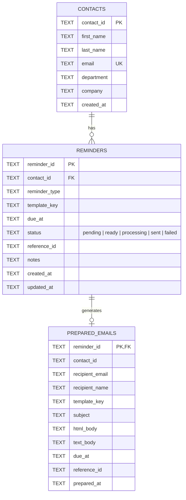

# Reminder Scheduling Architecture & Guide

**Project Name:** Email Automation & Reminder System  
**Project Author:** Akash Das  
**Development Environment:** Antigravity IDE (VS Code-based)  
**Project Lead & Reviewer:** ChatGPT  

---

## 1. Overview & Purpose
The **Reminder Scheduling Engine** (`src/email_automation/reminder_service.py` and `src/email_automation/scheduler.py`) manages the temporal evaluation of reminder tasks against system time. It identifies pending reminders whose `due_at` timestamp has arrived ($\le \text{current time UTC}$), executes personalization via Phase 6, transitions the reminder state atomically from `pending` to `ready`, and stages the rendered email payload for Phase 8 dispatch.

The scheduler operates completely decoupled from the Streamlit UI, avoiding framework-specific event loop locks.

---

## 2. SQLite Database Architecture

Centralized within `data/database/reminders.db` (enforcing WAL mode and foreign key constraints):



### Key Performance Indexes
- `idx_reminders_status_due`: B-tree index on `(status, due_at)` enabling $O(\log N)$ candidate lookups.

---

## 3. Reminder Status Lifecycle

The system enforces a strict operational lifecycle:

```text
[ pending ] ──( due_at <= now_utc )──> [ ready ] ──( Phase 8 Dispatch )──> [ processing ]
                                            │                                      │
                                            │ (Preparation failure)                ├──> [ sent ]
                                            ▼                                      ▼
                                       [ pending ]                             [ failed ]
                                     (error logged)
```

- `pending`: Waiting for scheduled due timestamp.
- `ready`: Due time reached; personalized HTML/text staged in `prepared_emails`.
- `processing`: Claimed by Phase 8 transport worker.
- `sent`: Successfully accepted by SMTP server.
- `failed`: Terminal failure recorded with error details.

---

## 4. Idempotent CSV Data Synchronization
- Initial sample data is imported via `import_or_sync_csv()`.
- Contacts use `INSERT ... ON CONFLICT(contact_id) DO UPDATE`.
- Reminders use `INSERT ... ON CONFLICT(reminder_id) DO UPDATE ... WHERE status = 'pending'`.
- **Duplicate Prevention Guarantee**: Re-running synchronization never overwrites or regresses reminders that are already `ready`, `processing`, or `sent`.

---

## 5. Temporal & Timezone Integrity
1. **Timezone Awareness**: All comparisons normalize to UTC.
2. **Datetime Comparison**: Timestamps are parsed into Python `datetime` objects with `timezone.utc`. String comparisons are strictly forbidden.
3. **Validation**: Naive or malformed timestamps are captured and reported in `SchedulingSummary.errors` without halting execution.

---

## 6. Concurrency, Atomic Transactions & Rollback Guarantee

When multiple worker processes evaluate due reminders simultaneously, race conditions and inconsistent states are prevented using an atomic transactional boundary:

```sql
BEGIN TRANSACTION;

-- 1. Conditional claim
UPDATE reminders
SET status = 'ready', updated_at = :now_utc
WHERE reminder_id = :reminder_id AND status = 'pending';

-- 2. Staging prepared email payload
INSERT INTO prepared_emails (
    reminder_id, contact_id, recipient_email, recipient_name,
    template_key, subject, html_body, text_body, due_at, reference_id, prepared_at
) VALUES (...);

COMMIT;
```

### Safety & Rollback Guarantees:
- **Single Transaction Scope**: Step 1 (status transition) and Step 2 (payload insertion) share the exact same database transaction managed by `with conn:`.
- **Atomic Rollback on Failure**: If the insertion into `prepared_emails` encounters any error (e.g. disk failure, foreign key mismatch, constraint violation), the transaction is immediately rolled back by SQLite. The reminder returns to `pending` and is **never** left stranded in `ready` without a prepared payload.
- **Worker De-confliction**: If two concurrent processes attempt to claim the same reminder, SQLite ensures only one receives `cursor.rowcount == 1`. The second worker receives `rowcount == 0` and skips without conflict.
- **Cross-Process Busy Handling**: Configured with `PRAGMA busy_timeout = 30000;` and `PRAGMA journal_mode = WAL;`, allowing concurrent readers and gracefully queuing simultaneous writers for up to 30 seconds. Verified via `test_cross_process_concurrency` using two separate operating system processes.

---

## 7. Command-Line Interface (CLI)

The scheduler is completely independent of Streamlit and can be managed via `main.py`:

```powershell
# 1. Initialize SQLite schema & indexes
python main.py init-db

# 2. Synchronize sample CSV records into SQLite
python main.py sync-data

# 3. Evaluate and prepare due reminders once
python main.py process-due

# 4. View prepared queue ready for Phase 8
python main.py list-prepared

# 5. Launch the continuous background scheduler loop
python main.py start-scheduler --interval 60
```

---

## 8. Automated Testing

Run the automated test suite in `.venv`:
```powershell
pytest tests/ -v
```
All 39 tests (18 scheduling tests and 21 personalization tests) run against isolated in-memory or temporary disk fixtures (`tmp_path`).
